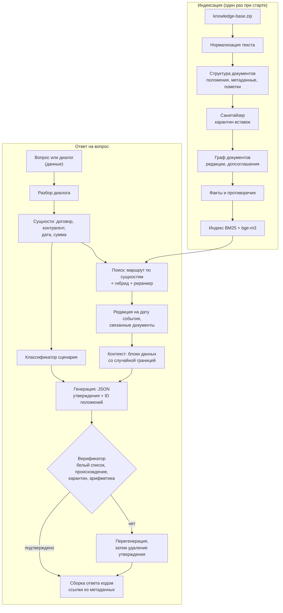

# Целевая архитектура

Документ описывает, к чему мы идём, и почему именно так. Детальные решения оформляем в `docs/adr/` (формат: контекст → варианты → решение → последствия). Ссылки вида PSB-N ведут на задачи в Jira.

## Принципы

1. **Граница доверия.** Инструкции — только из нашего кода. База знаний, вопрос и история диалога — данные. Подробно — в [модели угроз](07-security.md).
2. **Логика в коде, а не в одном промпте.** DeepSeek V4.1 Flash быстрая, но не самая сильная модель. Всё, что можно решить детерминированно (поиск документа по номеру, выбор редакции по дате, проверка чисел, формирование ссылок), решаем кодом.
3. **Каждый факт проверяем.** Выдумка обнуляет вопрос, поэтому структурированный вывод и верификатор — обязательные шаги.
4. **Один пайплайн для сабмита и веб-чата.** `solution.py` и HTTP API вызывают одно и то же ядро.
5. **Деградация вместо падения.** Недоступен эмбеддер — работаем на BM25. Кончается время — отключаем дорогие шаги. Файл ответа создаётся всегда.

## Пайплайн



## Компоненты

| Компонент | Ответственность | Задачи |
|---|---|---|
| Загрузка базы | Чтение ZIP: TXT, MD, DOCX (видимый текст отдельно от скрытого содержимого); тип документа | PSB-9, PSB-10, PSB-12 |
| Нормализация | Чистый текст, ключ сравнения, ключ детекции; находки (невидимые символы, tag-блок, bidi, смешение алфавитов, base64) | PSB-12 |
| Структура документа | Положения с адресом («п. 3.1», «ст. 70, абз. 9»), метаданные, редакционные пометки | PSB-9, PSB-10 |
| Санитайзер | Сигналы детекторов по каждому абзацу положения, решение о карантине, журнал | PSB-12 |
| Граф документов | Допсоглашения, редакции, письма-дополнения | PSB-11 |
| Факты и противоречия | Извлечение фактов, иерархия источников | PSB-54 |
| Каталог сущностей | Контрагенты и документы из шапок, падежные формы наименований, номера по частям; распознавание упоминаний в тексте | PSB-13 |
| Разбор диалога | Реплики входа кейса, последняя реплика пользователя, сущности и дата события из диалога, запрос для поиска, история для промпта | PSB-24 |
| Индекс и поиск | BM25 по n-граммам и номерам, эмбеддинги положений, слияние рангов; предрасчёт и проверка хеша базы | PSB-14, PSB-16 |
| Маршрутизатор | Документ целиком при явной сущности, связанные документы | PSB-17 |
| Редакции | Дата события → применимая редакция | PSB-18 |
| Классификатор | Сценарий запроса (см. [сценарии](03-scenarios.md)) | PSB-22 |
| Сборка контекста | Правила в system; данные в блоках с меткой запроса; замена маркеров ролей видимыми знаками; проверка границы | PSB-52 |
| Генератор | Один промпт на все сценарии (правила, примеры, напоминание), JSON с утверждениями, сверка с контекстом, один повтор | PSB-23, PSB-53 |
| Верификатор | Проверка покрытия величин, происхождение, карантин; перегенерация | PSB-31, PSB-32 |
| Сборка ответа | Текст по контракту, ссылки из метаданных | PSB-53 |
| Клиент прокси | chat (текст и JSON-режим с причиной завершения) / embeddings / rerank, повторы, тайм-ауты | PSB-4, PSB-53 |
| Оркестратор | Бюджет времени, параллелизм, запись `submission.csv` | PSB-5 |
| HTTP API и UI | Чат, источники, просмотр документа, срабатывания защиты | PSB-41, PSB-42 |

## Положения: адрес, ссылка, идентификатор

Положение — наименьшая единица, на которую ссылается ответ. Разбор выбирает способ деления по строению текста, а не по жанру: записка с нумерованными пунктами делится как регламент.

| Что | Как устроено | Пример |
|---|---|---|
| Документ с пунктами | Положение — пункт. Заголовки разделов и вводные пункты хранятся как путь | `п. 4.2`, путь: раздел 4 «Порядок расчётов» |
| Документ без пунктов | Положение — абзац основного текста, счёт с первого абзаца после шапки | `абз. 3` |
| Строки до первого пункта или абзаца | Шапка и вводная часть | `преамбула` |
| Ссылка | Собирается кодом из названия документа в тексте и адреса. У документа с редакциями в название входит редакция | «Договор поставки № П-17/2024, п. 4.2»; «Регламент … в редакции от 01.03.2025, п. 2.4» |
| Идентификатор положения | Идентификатор документа и порядковый номер положения в нём. Модель возвращает его в JSON, верификатор по нему находит текст | `d03.7` |
| Заголовок фрагмента для индекса | Документ, стороны, путь разделов, адрес | «Договор поставки № П-17/2024 (ООО «Альфа-Трейд», ООО «Меридиан»), раздел 4 «Порядок расчётов», п. 4.2» |

Метаданные документа (вид, номер, дата, стороны, редакция, статус) читаются из шапки текста. Имя файла используется только как название, если шапки в тексте нет. Статус «утратил силу» ставится по явной пометке в шапке; срок действия из условий договора в метаданные не извлекается — это работа карты связей (PSB-11).

### Статьи законов

Статья закона — тот же `Document` с теми же `Provision`, `cite()` и `context_heading()`. Отличаются заголовок (`LawArticleHeader`) и адрес положения (`LawAddress` — путь единиц и, если единица поделена, диапазон абзацев). Номер единицы хранится строкой: в НК есть «1.8-3».

| Акт | Единица `1.` | Единица `1)` | Пример ссылки |
|---|---|---|---|
| Налоговый и Гражданский кодексы | пункт | подпункт | «НК РФ, ст. 164, п. 1, подп. 2.1» |
| КоАП, федеральные законы | часть | пункт | «152-ФЗ, ст. 9, ч. 4, п. 2» |
| Статья без единиц `1.` (ТК, 82-ФЗ) | часть — абзац с прописной буквы, счёт с первого | пункт | «ТК РФ, ст. 70, ч. 5» |
| Раздел «Примечания:» в КоАП | примечание, нумерация заново | пункт | «КоАП РФ, ст. 13.11, прим. 2» |

Положение — наименьшая нумерованная единица вместе со своими абзацами без номера: перечень из абзацев со строчной буквы и абзац санкции в КоАП остаются в одном положении с вводной фразой. Вводная фраза родителя («Налогообложение производится по налоговой ставке 0 процентов при реализации:») сама остаётся положением и входит в путь заголовков своих подпунктов. Обозначение единицы («1.», «2.1)») в текст положения не входит — оно в адресе.

Единица длиннее `MAX_PROVISION_LENGTH` (2000 знаков) делится по границам абзацев на положения с тем же адресом и диапазоном абзацев: «п. 1, абз. 6–13». Разрыв допустим только после абзаца, законченного точкой или точкой с запятой, поэтому диспозиция и санкция, вводная фраза и первый элемент перечня не разделяются. Продолжение поделённого перечня получает вводную фразу в путь заголовков. Текст между положениями не дублируется; окно с перекрытием для абзаца длиннее порога — дело индекса (PSB-16).

Строки выгрузки, которые не являются нормами, в текст положений не попадают:

| Строка | Признак | Куда попадает |
|---|---|---|
| «Источник:», «URL:», «Дата выгрузки:» | имя поля до строки «Статья N.» | `LawArticleHeader`: акт, краткое обозначение, адрес страницы, дата |
| Комментарий справочной системы | сокращённый год «2026 г.» (нормы пишут «года») или нет знака препинания в конце | `amendments`, если это пометка с адресом, иначе `comments` |
| Пометка с адресом: «Пункт 3 изменен с …», «Статья 9 дополнена частью 9 с …» | шаблон `_AMENDMENT` | `AmendmentNote(target, effective_from, source_act)`; адрес — единица, перед которой стоит пометка; `target=None` — статья целиком |
| Заглушка: «4. Утратил силу …», «Абзац второй исключен.», «Часть вторая утратила силу.» | шаблоны `_REPEALED_*` | `RepealedUnit`: номер пункта, абзаца или части занят, текста нормы нет |

Признаки комментария проверены на 13 статьях базы (888 строк после шапки). Норма, в которой год записан как «2026 г.», будет принята за комментарий — на другой базе это нужно перепроверить. Проверка полноты в тестах: строки шапки, пометки, комментарии, заглушки и положения вместе дают исходный текст.

## Нормализация текста

`lex_normalization.py` даёт три представления одного текста. Разбор документов работает с исходным текстом; чистый текст и ключи строятся из текста положения.

| Представление | Функция | Что делает | Кто читает |
|---|---|---|---|
| Оригинал | `normalize(text).original` | ничего | журнал санитайзера |
| Чистый текст | `clean_text(text)` | NFC; удаляет категории Cf, Cc (кроме перевода строки и табуляции), Co, Cn и невидимые символы других категорий: селекторы вариантов, заполнители хангыля, пустой шаблон Брайля | индекс, контекст модели |
| Ключ сравнения | `comparison_key(text)` | чистый текст, один регистр, ё→е, все кавычки → `"`, все тире → `-`, пробельные символы → один пробел | поиск, каталог сущностей, сверка строк (PSB-13, 16, 31) |
| Ключ детекции | `normalize(text).detection_key` | ключ сравнения после NFKC; в слове со смешением кириллицы и латиницы буквы меньшинства заменяются похожими буквами большинства (12 пар); в конец дописаны раскодированные tag-символы и блоки base64 | только детекторы вставок |
| Ключ детекции с позициями | `detection_alignment(text)` | тот же ключ для видимого текста: пробелы не свёрнуты, разрывы строк на месте, раскодированных блоков нет; для каждого знака ключа известна позиция знака в тексте | замена маркеров ролей (PSB-52) |

NFKC и свёртка похожих букв есть только в ключе детекции: NFKC превращает «№» в «No», «м²» в «м2», «Ⅳ» в «IV». Таблица confusables из Unicode TR39 для свёртки не годится: она отображает кириллицу в латиницу.

`normalize(text).findings` — что нормализация убрала или раскрыла: число невидимых символов, раскодированный tag-блок, bidi-управление, слова со смешением алфавитов, раскодированный base64. Метка порядка байтов и мягкий перенос удаляются без находки. Слово, в котором заменены все буквы, смешением не считается и не сворачивается. Блоки hex не раскодируются.

### DOCX

`lex_docx_reading.read_docx` читает видимый текст (абзацы и строки таблиц в порядке документа, ячейки через ` | `) в тот же вид, что у TXT: одна строка — один абзац. Скрытый текст (`w:vanish` у фрагмента, его стиля знаков или стиля абзаца), комментарии, колонтитулы и основные свойства документа попадают в `Document.hidden` с видом `HiddenContentKind` и в положения не входят. Не читаются: вложенные таблицы, сноски, надписи, пользовательские свойства, наследование `w:vanish` через базовый стиль, текст, скрытый цветом или размером шрифта. DOCX, который не открывается, — `KnowledgeBaseError` с именем файла.

## Санитайзер базы

| Модуль | Что в нём |
|---|---|
| `lex_detection.py` | `Fragment` (абзац положения или скрытое содержимое), `Signal`, `SignalStrength`, протокол `Detector.inspect(fragment) -> Signal` |
| `lex_address_detection.py` | `AddressDetector`: классы признаков обращения к ИИ-системе |
| `lex_structure_detection.py` | `StructureDetector` (разметка, метки ролей, скрытый текст, текст после подписи), `ConcealmentDetector` (находки нормализации) |
| `lex_sanitizer.py` | `screen(base, detectors, thresholds) -> Screening`, `decide`, окно соседних абзацев, `admitted_text` |
| `lex_settings.py` | `SanitizerThresholds`: пороги агрегатора, маскировки и размер окна |
| `lex_injection_prompt.py` | Промпт классификатора `INJECTION_CLASSIFIER_PROMPT_V1`, примеры, сборка сообщений |
| `lex_injection_classifier.py` | `classify(fragment, model, marker)`, `review_suspects(screening, model, next_marker)`: решение по фрагментам со слабым сигналом за протоколом `ChatModel` |

Санитайзер документы не меняет. `Screening` — журнал решений по `ProvisionId` и номеру абзаца; индекс (PSB-16) берёт текст положения через `admitted_text`, сборка контекста (PSB-52) — через `admit`, которая возвращает `AdmittedProvision` или `None` для положения в карантине, верификатор (PSB-31) по тому же журналу отклоняет доказательства из карантина. Роль фрагмента отдельным `Enum` не заведена: её заменяют вердикт и признаки сигналов в журнале. Правила детекторов, измеренный recall и ограничения — в [модели угроз](07-security.md#санитайзер-базы).

## Сборка контекста

| Модуль | Что в нём |
|---|---|
| `lex_sanitizer.py` | `AdmittedProvision(id, heading, text)` и `admit(document, provision, screening)`: единственный вход положений в контекст |
| `lex_role_markers.py` | `find_role_markers(text)`, `neutralize_role_markers(text)`: классы маркеров ролей и токенов чат-шаблонов, замена краёв знаками ‹ и › |
| `lex_prompt_boundary.py` | `assemble_prompt(rules, provisions, history, question, boundary) -> list[ChatTurn]`, `boundary_violations(turns, rules, boundary)`, `Boundary`, `random_boundary()`, `PromptRules(system, reminder)`, пояснение к блокам `DATA_LEGEND_V1` |
| `lex_prompts.py` | `ANSWER_PROMPT_V1` — `PromptRules` генератора ответа; собран из `ANSWER_RULES_V1`, `ANSWER_EXAMPLES_V1` и `ANSWER_REMINDER_V1` |

Порядок в запросе: правила (system) → пояснение к блокам → блоки `provision` в порядке, заданном вызывающим кодом → блоки `turn` → блок `question` → повтор правил. Сборка ничего не ищет и не отбирает: положения и их порядок приходят от поиска, текст правил и повтора — `lex_prompts.ANSWER_PROMPT_V1`; что в нём написано и почему, описано в [docs/03](03-scenarios.md#правила-для-модели). Вопрос — строка, история — последовательность строк-реплик: их даёт [разбор диалога](#разбор-диалога) — `Question.text` и `prompt_history(question)`.

Метку запроса создаёт точка входа (`random_boundary()`), в сборку она приходит значением. Метка в данных и идентификатор положения, который ломает открывающую строку блока, — `PromptBoundaryError`. Формат блоков, классы маркеров, причины решений и ограничения — в [модели угроз](07-security.md#граница-доверия-в-промпте).

## Ответ модели: контракт и повтор

| Модуль | Что в нём |
|---|---|
| `lex_models.py` | `JsonChatModel.complete_json(turns) -> JsonCompletion(content, finish)`; `FinishReason`: `STOP`, `LENGTH`, `CONTENT_FILTER`, `UNRECOGNIZED` |
| `lex_gateway.py` | `ProxyGateway.complete_json`: тот же запрос, что у `complete`, плюс `response_format: {"type": "json_object"}` |
| `lex_scenarios.py` | `Scenario` — девять сценариев из [docs/03](03-scenarios.md), значения совпадают с метками golden-набора |
| `lex_answer_contract.py` | Схема `ModelAnswer`, `read_reply(completion, provisions, boundary)`, `correction_request(turns, problems, provisions)`, `generate(model, turns, provisions, boundary) -> Generation(answer, extra_call_spent, problems)` |

Схема ответа модели, поля в порядке генерации:

| Поле | Тип | Смысл |
|---|---|---|
| `scenario` | одно из значений `Scenario` | сценарий ответа |
| `claims[].ids` | список строк | идентификаторы положений из блоков `provision` запроса |
| `claims[].quote` | строка | дословный фрагмент текста одного из названных положений, не короче `MIN_QUOTE_LENGTH` знаков |
| `claims[].text` | строка | одно утверждение, без номеров пунктов и названий документов — ссылку добавит код |
| `missing` | список строк | чего в базе нет или что нужно уточнить |
| `verdict` | `yes`, `no`, `none` | прямой ответ на вопрос «да или нет»; генерируется последним |

Причина завершения решает, кто повторяет запрос. `insufficient_system_resource` и `aborted` — сбой провайдера: клиент прокси повторяет тот же запрос по своей политике. Пустой `content` и `length` клиент в JSON-режиме не повторяет и возвращает значением: при нулевой температуре тот же запрос даст тот же ответ, поэтому запрос меняет `generate`. `content_filter` и сбой прокси не повторяются вовсе — сразу безопасный ответ. Неизвестная причина завершения (`UNRECOGNIZED`) сама ошибкой не считается: содержимое всё равно проходит схему.

Проверка ответа идёт в два шага. Схема (`extra="forbid"`, строгие типы, `Enum`) — pydantic; ответ, не прошедший её, не используется совсем. Сверка с контекстом — по утверждениям: идентификатор из белого списка (`AdmittedProvision.id` переданных положений), цитата — подстрока текста одного из названных положений по `comparison_key`. Утверждение, не прошедшее сверку, можно удалить, не теряя остальные. Если удалено хотя бы одно, вердикт сбрасывается в `none`: «да» опиралось на все утверждения.

Повторный запрос — тот же запрос, к последнему сообщению которого после повтора правил дописан перечень ошибок (`ANSWER_CORRECTION_V1`). В перечне только наш текст, имена полей контракта и идентификаторы положений контекста. Прошлый ответ модели в запрос не возвращается, имена лишних полей и чужие идентификаторы не цитируются: ответ мог повторить текст, которому модель последовала из данных. Сообщений по-прежнему два, и запрос проходит `boundary_violations` с повтором правил, продлённым на перечень.

После повтора берётся последний ответ, прошедший схему; если повтор схему не прошёл или прокси не ответил — прошедшая сверку часть первого ответа. Все утверждения удалены или в ответе нет ни утверждений, ни недостающего — `NO_DATA_ANSWER`. Исключение — сценарии `off_topic` и `role_attack`: их текст даёт шаблон, пустой ответ модели для них законен.

Ограничения. Белый список и цитата проверяют опору утверждения, но не его формулировку: число в `text`, которого нет в названных положениях, ловит [верификатор](#верификатор). Утверждение с несколькими идентификаторами проходит, если цитата найдена хотя бы в одном из названных положений. Поле `missing` — свободный текст модели без опоры на положение.

## Верификатор

`lex_verification.verify(answer, context, question, screening, graph) -> VerificationReport` — **проверка покрытия величин**: каждая величина в `text` утверждения должна найтись в положениях из его `ids`. Модель не вызывается. Название выбрано намеренно: в FActScore и RAGAS подтверждение оценивает модель, здесь сверяются только значения.

Величины и даты находит `lex_fact_extraction.find_facts`, числительные прописью читает `lex_numerals`. Факт — значение (`Fraction`), единица, оператор, признак НДС и место в тексте; дата — `PartialDate` с оператором. «450 000 рублей», «450 тыс. руб.» и «четыреста пятьдесят тысяч рублей» — один факт; пара «450 000 (четыреста пятьдесят тысяч)» — тоже один. Сравнение «тот же факт» — `same_fact`.

Что считается величиной, а что нет:

| в тексте | результат |
|---|---|
| «450 000 рублей», «0,1%», «5 рабочих дней», «шести месяцев», «24 часа» | величина с единицей |
| «5-го числа», «пятого числа» | день месяца — отдельная единица, не срок и не дата |
| «500 000», «в 3 экземплярах», «четырнадцати» | число без единицы; прописью — только от десяти («один из», «две стороны» — не величины) |
| «01.08.2024», «в августе 2024 года», «первого августа 2024 года» | дата с точностью |
| «п. 3.1», «ст. 13.11», «№ П-17/2024», «152-ФЗ», «ИНН …», «каб. 412», «склад № 3», «1)» | реквизит или адрес, не величина: ссылки проверяет белый список идентификаторов |
| «3.1» с точкой и без единицы | номер пункта: десятичный знак — запятая |

Правила сверки:

- **Единица совпадает точно.** Календарные, рабочие, банковские дни и «дни» без уточнения — четыре единицы; недели, месяцы и годы не пересчитываются. Число без единицы в ответе подтверждает то же число с любой единицей.
- **Оператор — часть факта**: «не более», «не менее», «свыше», «менее», «до», диапазон. Синонимы сведены в группы («не более» = «не может превышать» = «не позднее» = «максимум»). «В течение 5 дней» оператора не несёт. Два послабления, без которых верные ответы отклонялись: «порог — 15 000 000» подтверждается любой границей источника («свыше 15 000 000»); величина источника без своего оператора наследует оператор предыдущей величины того же вида в том же предложении («не может превышать трёх месяцев, а для руководителей — шести месяцев»).
- **НДС** сверяется, только если ответ его назвал.
- **Дата** в ответе не точнее источника: «в 2024 году» подтверждается «1 августа 2024 г.», обратное — нарушение.
- **Происхождение.** Источники утверждения — положения из его `ids` (текст и заголовок с реквизитами документа) и положения контекста, которые меняют их по графу (`DocumentGraph.versions_of`: новая редакция пункта из допсоглашения). Величина из другого положения контекста утверждение не подтверждает.
- **Число из вопроса** (повтор слов пользователя: «а не 500 000») помечается `from_question`: не провал и не подтверждённый факт. Оператор при этом не сверяется.
- **Карантин.** Провал, если величины нет ни в одном положении контекста, но она есть в карантинном фрагменте, или если утверждение повторяет пять и более слов подряд из карантинного фрагмента, которых нет в контексте. Текст такого утверждения и его величин в отчёт не попадает.
- **`missing`** — свободный текст без опоры: в нём не должно быть величин не из вопроса и номеров документов из контекста. В сценарии `ambiguous` строка называет, что уточнить, и может перечислять величины и документы контекста.

Виды нарушений — `ViolationKind`: `VALUE_NOT_FOUND`, `FOREIGN_SOURCE`, `UNIT_MISMATCH`, `BOUND_MISMATCH`, `VAT_MISMATCH`, `DATE_MORE_PRECISE`, `QUARANTINED_VALUE`, `QUARANTINED_WORDING`, `MISSING_STATES_VALUE`, `MISSING_NAMES_DOCUMENT`. Значение — строка для интерфейса. `VerificationReport` — pydantic-модель: по каждому утверждению признак `confirmed`, нарушения и проверки величин (`wording`, `support`, `confirmed_by`); в JSON и обратно переводится без потерь.

`apply_report(generation, report) -> Correction` убирает неподтверждённые утверждения и строки `missing`; вердикт «да/нет» при этом сбрасывается, а ответ без утверждений и без `missing` становится `NO_DATA_ANSWER`. `Correction.regeneration_worthwhile` истинно, если отчёт что-то отклонил, а `Generation.extra_call_spent` ложно: повтор по контракту и перегенерация делят один вызов. Саму перегенерацию делает PSB-32.

Чего верификатор не проверяет:

- смысл утверждения и связь величины с предметом («450 000 — это штраф», когда в пункте это арендная плата), отрицание — это проверка с моделью (PSB-33);
- производные числа: сумма, произведение, пересчёт единиц без опоры в положении — нарушение `VALUE_NOT_FOUND`; проверки арифметики при явной формуле пока нет;
- период ставки («в месяц», «за каждый день»), доли («1/300»), время суток, «30-дневный», «в полуторном размере», диапазон прописью с границей меньше десяти («от трёх до пяти дней») — не разбираются, одинаково в ответе и в источнике;
- названия документов и контрагентов в тексте утверждения.

Цифры на демо-ответах (`tests/golden/verification.yaml`): 9 из 9 утверждений верных ответов подтверждены (ложных срабатываний 0; 7 величин подтверждены положением, 3 повторяют вопрос), 9 из 9 искажений пойманы. Извлечение (`tests/golden/fact_extraction.yaml`): 27 из 27 пар «цифры (прописью)» базы сходятся.

## Сборка ответа

`lex_answer_rendering.render(answer, base) -> str` — чистая функция: `GroundedAnswer` из `lex_answer_contract` и база. Порядок частей: первая фраза (вердикт или шаблон сценария) → утверждения со ссылками → перечень недостающего. Правила ссылок и шаблоны по сценариям описаны в [docs/03](03-scenarios.md#кто-пишет-текст-ответа).

Ссылку получает только положение из `GroundedClaim.provisions`, а туда попадают лишь идентификаторы из белого списка контекста. Текст ссылки — `cite()` или адрес положения; строк модели в ссылке нет. Отсюда свойство: какой бы идентификатор ни вернула модель, в тексте ответа есть ссылки только на положения контекста (тест перебирает случайные ответы с чужими и несуществующими идентификаторами). Идентификатор, которого нет в базе, — `VerificationError`: такой ответ собран не из этой базы.

Оговорки о применённой редакции и об отсутствии даты в вопросе рендерер не добавляет: редакцию выбирает код (PSB-18), и вход для этих фраз появится вместе с пайплайном. Сейчас редакция видна в ссылке: `cite()` включает её в название документа.

## Каталог сущностей

`lex_entity_catalog.build_catalog(base)` собирает `EntityCatalog` из шапок документов компании. Имена файлов и заранее известные наименования не используются; статьи законов в каталог не входят.

| Что | Откуда | Как хранится |
|---|---|---|
| Контрагент (`Counterparty`) | `DocumentHeader.parties` | наименование как в шапке, ИНН, роли по всем документам, документы, слова наименования (`NameToken`) |
| Документ (`DocumentEntry`) | шапка | вид, заголовок для ссылки, номер по частям (`DocumentNumber`), дата редакции |

**Один контрагент.** Стороны с одним наименованием (по `comparison_key`) — один контрагент, пока ИНН у наименования не больше одного: в допсоглашении сторона названа без ИНН. Два ИНН у одного наименования — два контрагента, сторона без ИНН остаётся третьей записью.

**Слова наименования.** Берётся текст в кавычках, без них — наименование без организационно-правовой формы в начале; дефис и пробел равнозначны: «ООО «Альфа-Трейд»» → «альфа», «трейд». Для каждого слова `lex_declension.case_forms` порождает падежные формы по закрытой таблице окончаний именительного падежа (21 окончание и слова на согласную, беглая гласная в «-ок/-ек/-ец»). Слово из вопроса сравнивается с формами целиком, поэтому «трейдинг» не форма слова «трейд». Латиница, слова с цифрами и слова короче трёх букв не склоняются. Стеммер Snowball для этого не годится: он даёт разные основы у «Меридиан» и «Меридианом» и одну у «Гарант» и «Гарантия».

**Обычное слово.** `NameToken.common` — какая-то форма слова встречается в положениях базы целиком строчными буквами («склад» в «склад № 3»). Такое слово в одиночку контрагента не называет.

**Номера.** `lex_document_numbers` разбирает номер на префикс, число и год: «П-17/2024», «П-17-2024», «п17/2024», «П 17/2024», «п-17/24», «П-017/2024» — один номер. Сравнение точное и по частям, без нечёткого: «П-17/2023» — другой документ. Префикс сравнивается в трёх прочтениях: как набрано, по начертанию (латинская «A» → «А») и по звучанию (латинская «P» → «П»). Без года номером считается только запись через дефис («ЮО-7»), иначе номером стал бы «п. 17». Номер другого вида («№ 1» допсоглашения, «14-П») в части не разбирается, и по номеру такой документ не находится.

### Распознавание упоминаний

`lex_entity_recognition.recognize(text, catalog)` возвращает `Mention(text, resolution)` на каждое упоминание в порядке появления. Результат даётся на упоминание, а не на вопрос: «сравни П-17/2024 и договор с «Альфа-Трейдингом»» — два результата, и расхождение номера с наименованием видно вызывающему. `resolution` — одно из трёх: `Resolved(entity, evidence)`, `Ambiguous(candidates, evidence)`, `NotFound(similar)`.

| Уровень (`Evidence`) | Что совпало |
|---|---|
| `IDENTIFIER` | ИНН из каталога; номер документа так, как он стоит в шапке: префикс, число и год |
| `FULL_NAME` | все слова наименования подряд, каждое в любой падежной форме; между словами пробел или дефис |
| `PARTIAL` | часть наименования из слов подряд («Альфа»); номер без года («П-17») |
| `FUZZY` | наименование с опечаткой; ответ должен назвать контрагента полностью |

Правила, в порядке применения:

1. **Совпадения с одним и тем же местом текста** сводятся к сильнейшему уровню; при равном уровне именительный падеж сильнее косвенного («Логистика» — это ООО «Логистика», а не родительный падеж ООО «Логистик»). Остался один кандидат — `Resolved`, несколько — `Ambiguous` со всеми кандидатами.
2. **Самое длинное совпадение гасит пересекающиеся:** «Альфа-Трейдинг» не даёт второго упоминания «Альфа».
3. **Когда возвращается `Ambiguous`:** часть наименования есть у нескольких контрагентов («Альфа», «с Альфой»); падежная форма общая у двух наименований и ни одно не стоит в именительном падеже; номер без года подходит к документам разных лет; опечатка не отделяет лучшего кандидата от остальных.
4. **Когда возвращается `NotFound`:** номер назван с годом, а документа с таким годом нет (`similar` — документы с тем же префиксом и числом); номер записан слитно с годом из четырёх цифр, и такой серии в базе нет; организационно-правовая форма с наименованием в кавычках, которого нет в каталоге («ООО «Альфа-Банк»»). Обычный текст без этих признаков упоминанием не считается, результат — пустой кортеж.
5. **Заглавная буква или кавычки** обязательны для части наименования, для наименования из одного слова и для наименования из одних обычных слов базы. Строчными буквами узнаётся только полное наименование из нескольких слов («у альфа-трейда»). Слово «склад» частью наименования не становится никогда: «к нашему складу в Химках» — не упоминание.
6. **Границы наименования:** совпадение не разрывает слово через дефис («Альфа-Банк») и текст в кавычках («Альфа Банк» в кавычках) — это другое наименование.
7. **Опечатки** проверяются только там, где нет точного совпадения. Расстояние OSA (перестановка соседних букв — одна правка) считается по словам до ближайшей падежной формы; лимит по длине именительного падежа: до 5 букв — 0, 5–8 — 1, от 9 — 2. `Resolved` — если остальные кандидаты дальше лучшего не меньше чем на 2 правки, иначе `Ambiguous`. Скореры `partial_ratio` и `WRatio` не используются: на паре «трейд» — «трейдинг» они дают 100 и 90.
8. **Номера и ИНН** сравниваются только точно.

**Диалог.** `recognize` принимает текст одной реплики. `combine_turns(turns)` объединяет результаты нескольких реплик и снимает `Ambiguous`, когда ровно один из его кандидатов назван в переданных репликах однозначно (демо 17: «с Альфой» → «Альфа-Трейдинг»). Какие реплики передавать, решает [разбор диалога](#разбор-диалога): он передаёт только реплики пользователя. Реплика ассистента в демо 17 называет обоих кандидатов и неоднозначность не снимает.

Ограничения, проверенные на базе и записанные в `tests/golden/entity_recognition.yaml`:

- настоящее слово в одной правке от наименования даёт `FUZZY`: «альфа трейдер» → ООО «Альфа-Трейд»;
- «Северный» в начале предложения — `PARTIAL` для ООО «Северный Склад»; без кавычек и дефиса «Альфа Банк» даёт `Ambiguous` по слову «Альфа»;
- косвенные признаки (предмет договора, адрес объекта) не используются: «„Альфа“ привезла мебель» остаётся `Ambiguous`;
- регламент по названию и статья закона по номеру («ст. 70 ТК») не распознаются: в каталоге только контрагенты и номера документов компании.

## Граф документов

`lex_document_graph.build_graph(base)` строит неизменяемый `DocumentGraph` из текста документов компании. Имена файлов не используются; статьи законов в граф не входят. Решения и отвергнутые варианты — в [ADR 0002](adr/0002-document-graph.md).

| Модуль | Что в нём |
|---|---|
| `lex_document_links.py` | `find_link_statements(document)`: утверждения о связях в тексте одного документа. Адресат записан так, как его называет источник (`DocumentReference`: слова названия, номер, дата редакции) |
| `lex_document_graph.py` | `build_graph`: поиск адресата в базе, семейства редакций, запросы к графу |

| Связь (`LinkKind`) | Признак в тексте | Пример |
|---|---|---|
| `AMENDS` | строка «к <документу> № …» в шапке дополнительного соглашения | «к договору поставки № П-17/2024 от 12 февраля 2024 г.» |
| `SUPERSEDES` | «Редакция от <дата> утрачивает силу» с датой другой редакции | регламент в редакции от 01.03.2025 → редакция от 10.01.2023 |
| `REPLACES_PROVISION` | «Изложить пункт N … в следующей редакции:» и текст в кавычках за ним | допсоглашение № 1 → п. 3.2 договора П-17/2024 |
| `SUPPLEMENTS` | «в дополнение к … п. N <Название> (ред. от <дата>)» | письмо К-12 → п. 5.4 регламента в редакции от 01.03.2025 |

`Link` хранит источник, положение источника, в котором связь названа (`stated_in`), адресата дословно (`reference`), найденный документ (`target`), названный пункт и его положение (`clause`, `target_provision`), дату начала действия (`effective_from`) и условие применения (`condition`). Связь без единственного адресата остаётся в графе с `target=None`.

| Запрос | Что возвращает |
|---|---|
| `amendments_of(document)` | допсоглашения к документу |
| `links_from(document)`, `links_to(document)` | связи, названные в документе, и связи, которые на него указывают |
| `family_of(document)` | `EditionFamily` — редакции одного документа с периодами `effective_from`/`effective_to`; `None`, если у документа нет даты редакции |
| `EditionFamily.edition_at(date)` | редакция, действовавшая на дату; `None` — такой редакции в базе нет |
| `versions_of(provision_id)` | исходный текст пункта и его новые редакции (`ProvisionVersion`); пусто, если пункт не менялся |
| `unresolved` | связи без адресата или без названного пункта в адресате |

Конец периода — первый день, когда редакция уже не действует: у регламента 2023 года это 01.03.2025, и `edition_at(01.03.2025)` возвращает редакцию 2025 года. Изменённый пункт не переписывается: текст положения в базе остаётся исходным, новая редакция лежит в графе рядом с ним. У новой версии есть `changed_by`, `effective_from` и `condition` — текст условия дословно и положение, откуда он взят («Новый адрес доставки применяется к партиям Товара, Спецификации на которые подписаны после 1 октября 2024 г.», допсоглашение № 1, абз. 3). Условие код не вычисляет: сборка контекста (PSB-52) отдаёт модели обе версии и условие.

Что граф не извлекает: ссылки на положение другого документа без слов «в дополнение к», связи по теме без названного документа, приложения и спецификации к договору.

## Дата события и редакция

Решения и отвергнутые варианты — в [ADR 0003](adr/0003-event-date-and-edition.md).

### Дата события

`lex_dates.PartialDate(start, precision)` — дата с точностью до дня, месяца или года; это период с первым днём `start` и первым днём после него `end`. `find_dates(text)` находит «01.08.2024», «1 августа 2024 г.», «в августе 2024 года», «в 2024 году» и место каждой даты в тексте. Тип общий: им же верификатор (PSB-31) будет сверять даты ответа.

`lex_event_date.read_event_date(question, today)` читает дату события. День вопроса `today` передаёт вызывающий, системное время ядро не читает. Относительные даты считаются календарными периодами: «в прошлом году» — предыдущий календарный год, «в прошлом месяце» — предыдущий месяц, «вчера» — предыдущий день.

| Результат | Когда |
|---|---|
| `EventDate(period, wording)` | В вопросе одна дата, и она стоит не после «от» |
| `UnclearEventDate(candidates, incomplete)` | Дат несколько; единственная дата — реквизит документа («в редакции от 02.02.2029»); дату нельзя вычислить («в августе» без года, «два года назад») |
| `None` | Дат и слов о времени нет |

Между несколькими датами код не выбирает: все даты возвращаются в порядке текста с ролью (`STATED` или `DOCUMENT_DATE`).

### Редакция документа компании

`lex_edition_choice.edition_on(family, period, base)` выбирает редакцию семейства из [графа](#граф-документов) для названного периода; `current_edition(family, today, base)` — для вопроса без даты.

| Результат | Когда | Что делает ответ |
|---|---|---|
| `EditionInForce(edition, date_stated=True)` | Весь период приходится на одну редакцию | Отвечает по ней |
| `EditionInForce(edition, date_stated=False)` | Даты в вопросе нет | Отвечает по действующей и говорит об этом одной фразой |
| `EditionsAcrossBoundary(editions, boundaries)` | Период захватывает смену редакций: «в 2025 году» при смене 01.03.2025 | Приводит оба варианта с днём смены или просит уточнить дату |
| `NoEditionOnDate(reason)` | Дата раньше первой редакции либо редакция утратила силу, а следующей нет | Говорит, что редакции на эту дату в базе нет |
| `RepealDateUnknown(edition)` | «Утратила силу» без даты, следующей редакции нет | Говорит, что дата утраты силы в базе не названа |

День смены относится к новой редакции: 28.02.2025 — редакция 2023 года, 01.03.2025 — редакция 2025 года. Суммы и пороги модуль не читает: он выбирает документ, а положение с порогом находит поиск.

### Норма закона на дату события

Прежних редакций норм в базе нет. `lex_law_validity.law_text_on(header, address, period)` по пометкам об изменениях отвечает, относится ли текст базы к дате события; `law_text_as_retrieved(header, address)` — для вопроса без даты.

| Результат | Когда |
|---|---|
| `LawTextInForce(amended, date_stated)` | Дата события не раньше последнего изменения единицы, её родителя и статьи |
| `LawTextNewer(amended)` | Норма изменена позже даты события: редакции на эту дату в базе нет |
| `LawTextUncertain(reason, note)` | Определить нельзя: будущая пометка (`PENDING_AMENDMENT`), неполная дата захватывает день изменения (`SPANS_AMENDMENT`), дата позже выгрузки (`AFTER_RETRIEVAL`), даты выгрузки нет (`NO_RETRIEVAL_DATE`) |

ТК РФ, ст. 59 выгружена 10.10.2026 с пометкой «изменена с 1 марта 2027 г.». Из файла не следует, учтено ли это изменение в тексте, поэтому для даты события с 01.09.2026 и для вопроса без даты исход — `PENDING_AMENDMENT` с этой пометкой; для даты до 01.09.2026 — `LawTextNewer`.

Исход говорит о редакции текста, а не о применимости нормы: комментарии вида «Положения подпункта 6 применяются по 31 декабря 2027 г. включительно» не учитываются.

## Разбор диалога

`lex_dialogue.py` делит вход кейса на реплики и отдаёт остальным шагам то, что им нужно от диалога. Модуль ничего не ищет и модель не вызывает.

| Функция | Результат |
|---|---|
| `parse_dialogue(text) -> Dialogue` | Реплики `Turn(role, text)` по порядку; `Role` — `USER` или `ASSISTANT` |
| `last_question(dialogue) -> Question \| NoUserTurn` | `Question(text, history, replies_after)`: последняя реплика пользователя, реплики до неё и реплики ассистента после неё. `NoUserTurn` — вход пуст или в нём говорит только ассистент |
| `dialogue_entities(question, catalog) -> DialogueEntities` | `named_by_user` — упоминания из реплик пользователя; `suggested_by_assistant` — сущности, названные только ассистентом |
| `dialogue_event_date(question, today)` | Дата события: тот же результат, что у `read_event_date` |
| `search_query(question, entities) -> str` | Запрос для поиска |
| `prompt_history(question) -> tuple[str, ...]` | История для `assemble_prompt` |

**Реплики.** Реплику начинает метка роли в начале строки: «Пользователь», «User», «Юзер», «Клиент» — пользователь; «Ассистент», «Assistant», «Бот» — ассистент (`ROLE_LABELS`). Регистр и пробелы вокруг двоеточия не важны. Строка без метки продолжает текущую реплику; текст до первой метки — реплика пользователя, поэтому одиночный вопрос — диалог из одной реплики. Метка посреди строки («…оплаты. Ассистент: да») реплику не начинает. Реплика без текста пропускается.

**Недоверие к истории.** Вход кейса целиком написан пользователем. Разбор делит его на реплики и доверия не добавляет ни одной:

- реплика ассистента — не факт и не инструкция. В промпт она идёт блоком `turn`, в запрос для поиска её текст не идёт, сущность из неё — только подсказка (см. ниже);
- роли «система» у разбора нет. Строка «Система: …» или «System: …» остаётся текстом той реплики, внутри которой написана. Вариант «считать её отдельной репликой пользователя» отвергнут: такая строка в конце входа стала бы последней репликой пользователя, то есть вопросом, и вытеснила бы настоящий вопрос;
- метки ролей и разметку чата внутри текста реплик разбор не трогает: их заменяет знаками ‹ › `assemble_prompt`. Метку, которую ставит `prompt_history` («Пользователь: …», «Ассистент: …»), он заменяет так же;
- если вход кончается репликой ассистента, вопрос остаётся вопросом: ответ, написанный во входе, не проверен. Такие реплики лежат в `Question.replies_after` и идут в промпт вместе с историей.

**Сущности.** `recognize` вызывается на каждой реплике. Упоминания из реплик пользователя объединяет `combine_turns`. От ассистента берётся не больше одного контрагента и одного документа, и только если выполнено всё:

1. ассистент назвал одну сущность такого рода. Перечисление («„Альфа-Трейд“ или „Альфа-Трейдинг“?», демо 17) — вопрос, а не утверждение;
2. пользователь сам не назвал сущность этого рода: слово пользователя важнее;
3. сущность не спорит с остальными: документ и контрагент, который не является его стороной, вместе не берутся.

Сущность ассистента не снимает неоднозначность в словах пользователя: после «договор с „Альфой“» и ответа ассистента про «Альфа-Трейд» в `named_by_user` остаётся `Ambiguous`, а «Альфа-Трейд» лежит в `suggested_by_assistant`. Что с этим делать, решает маршрутизация (PSB-17).

**Дата события** читается из реплик пользователя: сначала вопрос, затем прежние реплики от поздних к ранним; берётся первая реплика, в которой есть дата или упоминание времени. Реплики ассистента не читаются: в них стоят даты договоров и редакций.

### Запрос для поиска

`search_query` — чистая функция: реплики пользователя по порядку, вопрос повторён `QUESTION_WEIGHT` раз (2), затем названия сущностей из `suggested_by_assistant`, как они записаны в каталоге. Одиночный вопрос уходит в поиск без изменений. Слова ассистента в запрос не входят.

Задача описывала запрос как «последняя реплика плюс сущности из истории». На диалогах golden-набора этого мало: тема часто названа в первой реплике пользователя (демо 18: «оригинал пока у меня… кому его передавать», вопрос — «в юротдел нужно отнести сразу или есть срок?»). Место первого источника в выдаче BM25 на настоящей базе:

| Запрос | demo-06 | demo-15 | demo-16 | demo-17 | demo-18 | team-20 |
|---|---|---|---|---|---|---|
| Текст кейса целиком, с репликами ассистента | 4 | 3 | 2 | 1 | 2 | 1 |
| Только последняя реплика | 2 | 30 | 1 | 2 | 48 | 9 |
| Последняя реплика и названия сущностей | 2 | 12 | 1 | 2 | 18 | 2 |
| Все реплики пользователя и подсказанные сущности, вес вопроса 1 | 4 | 17 | 1 | 1 | 2 | 1 |
| То же, вес вопроса 2 (выбрано) | 3 | 8 | 1 | 1 | 2 | 1 |
| То же, вес вопроса 3 | 3 | 9 | 1 | 1 | 2 | 1 |

Вес вопроса нужен, когда прежняя реплика спрашивала о другом: в демо 6 сначала речь о гарантийном сроке, затем о приёмке. Вес подобран на шести диалогах — это мало; его перепроверяют на расширенном наборе (PSB-36).

Цифры выбранного варианта для всех семи кейсов с несколькими репликами лежат в `tests/golden/dialogue.yaml` (место первого источника / место, к которому найдены все):

| Кейс | Текст кейса целиком | Запрос из диалога |
|---|---|---|
| demo-06 | 4 / 38 | 3 / 37 |
| demo-15 | 3 / 3 | 8 / 8 |
| demo-16 | 2 / 2 | 1 / 1 |
| demo-17 | 1 / 1 | 1 / 1 |
| demo-18 | 2 / 2 | 2 / 2 |
| team-06 | 1 / 18 | 20 / 22 |
| team-20 | 1 / 10 | 1 / 5 |

Первый источник в первых пяти положениях: 7 из 7 по тексту целиком, 5 из 7 по запросу из диалога; в первых десяти — 7 из 7 и 6 из 7. Хуже стали demo-15 и team-06: слова, по которым находится пункт («условия возврата помещения», «п. 3.1 договора аренды № А-08/2024»), стоят в реплике ассистента. В обоих кейсах договор назван в диалоге, и в контекст его целиком отдаст маршрутизация (PSB-17).

Ограничения:

- отрицание без названной сущности («нет, не про него») не распознаётся: подсказка ассистента остаётся;
- вопрос-уточнение без собственных слов («а точнее?») ищется по словам прежних реплик пользователя; переформулировки моделью нет;
- метка роли с украшениями («**User:**», «[Ассистент]:», «> Бот:») реплику не начинает — такая строка остаётся текстом текущей реплики.

## Поиск положений

`lex_retrieval.py` задаёт протокол `Retriever`: `retrieve(query, limit)` возвращает `RankedProvision` (положение и оценка) по убыванию оценки. При равных оценках положения идут в порядке базы, поэтому выдача одинакова от запуска к запуску. Оценки сравнимы только внутри одной выдачи.

Индекс строится из `AdmittedProvision` (`lex_sanitizer.admitted_provisions(base, screening)`), другого входа у него нет: абзац в карантине не попадает ни в индекс, ни в выдачу.

### Что индексируется

Единица индекса — положение. Индексируется заголовок фрагмента (`context_heading`: документ, стороны, редакция, путь разделов, адрес) и за ним текст положения. Номер договора, контрагент и редакция названы в шапке документа, а не в каждом пункте, и без заголовка у пункта нет общих слов с вопросом «по договору с ООО „Северный Склад“». На golden-наборе тот же BM25 по одному тексту положения находит источник в первых пяти положениях в 25 кейсах из 36, с заголовком — в 30; MRR 0,587 и 0,697.

### Токены

`lex_search_tokens.search_tokens(text)` — один разбор для индекса и запроса, поверх `comparison_key`.

| Что в тексте | Токены | Зачем |
|---|---|---|
| слово: «договора» | символьные 4-граммы с метками границ: `_дог`, `дого`, `огов`, `гово`, `овор`, `вора`, `ора_` | морфологии в разрешённых пакетах нет; словоформы сближают общие n-граммы |
| слово до двух букв: «по» | `_по_` | короче n-граммы |
| номер: «П-17/2024», «13.11», «152-ФЗ», «0,1» | целый токен и его части: `п-17/2024`, `_п_`, `17`, `2024` | «П-17/2024» и «П-17/2023» — разные документы; части нужны для записи «п17/2024» |
| сумма: «450 000» | `450000` | разряды через пробел и без него — одно число |
| составное слово: «Альфа-Трейд» | n-граммы слов «альфа» и «трейд» | дефис и пробел в наименовании равнозначны |

Длина n-граммы — `WORD_NGRAM_LENGTH = 4`. На golden-наборе 3-, 4- и 5-граммы дают 29, 30 и 29 кейсов из 36 в первых пяти положениях: разница в один кейс выбор не обосновывает. В эксперименте на демо-вопросах обрезка слов до 5 букв, стеммер и 4-граммы различались на 1–2 пункта из 20. 4-граммы взяты потому, что не требуют таблиц окончаний. Стоп-слов нет: их влияния в том же эксперименте не видно (±1 пункт).

Известная неточность: «п. 5 100 рублей» читается как число 5100.

### BM25

`LexicalRetriever` строит индекс `bm25s` один раз в конструкторе; `k1 = 1,5`, `b = 0,75` (значения по умолчанию; на демо-вопросах k1 от 0,9 до 1,5 и b от 0,4 до 0,75 дают разницу в один пункт из 20). Положение без единого общего токена с запросом в выдачу не входит; пустой запрос и пустая база дают пустую выдачу.

`bm25s`, а не `rank-bm25`: качество у них одинаковое, но `rank_bm25.BM25Okapi` на малой базе даёт отрицательные оценки. Проверено на трёх документах `[a b]`, `[a c]`, `[a b d]` и запросе `b`: оценки −0,096; 0; −0,079 — документ без слова запроса оказывается выше документов с ним. У `bm25s` с вариантом `lucene` вес редкости неотрицателен (0,201; 0; 0,167), и нулевая оценка означает «совпадений нет». Скорость на выбор не влияет: на 1105 абзацах базы запрос занимает 0,14 мс у `bm25s` и 1,21 мс у `rank-bm25`.

### Оценка поиска

`tests/retrieval_eval.py` переводит поле `sources` кейсов `eval/cases.yaml` в идентификаторы положений (формат — в [eval/README.md](../eval/README.md#поле-sources)) и считает для каждого кейса место первого найденного источника и место, к которому найдены все. Запрос — текст кейса как есть: диалог уходит в поиск целиком, вместе с репликами ассистента. Сравнение с запросом, который строит разбор диалога, — в разделе [«Разбор диалога»](#запрос-для-поиска). Кейсы без источников и кейсы, чей источник не удалось перевести в положения, считаются отдельно и в метрики не входят.

Цифры на настоящей базе лежат в `tests/golden/retrieval.yaml`; тест падает, если они изменились. BM25, 36 кейсов с источниками из 39 (три кейса без источников, неразобранных источников нет), MRR 0,697:

| В первых k положениях | k = 5 | k = 10 | k = 20 |
|---|---|---|---|
| хотя бы один источник | 30/36 | 31/36 | 32/36 |
| все источники кейса | 21/36 | 26/36 | 30/36 |

BM25 не находит в первых десяти положениях: «в два часа ночи» → «круглосуточный доступ» (demo-07, место 22), «сдать часть склада другой компании» → субаренда (team-15, 21), «МРОТ» → «минимальный размер оплаты труда» (team-10, 21), «не платить НДФЛ» → «налог на доходы физических лиц» (team-12, 20) — перефразировки и сокращения, общих токенов с положением нет. Пятый кейс — «в какой срок оплатить поставку по договору с „Альфа-Трейд“» (team-01, место 30): документ найден, первые восемь положений выдачи — из договора П-17/2024 и допсоглашения к нему, но пункт 4.2 о сроке оплаты среди них не первый. Такой вопрос закрывает маршрут по сущностям (PSB-17): названный договор уходит в контекст целиком.

### Векторный поиск

`lex_dense_retrieval.py`. `embed_provisions(provisions, embedder, batch_size)` считает эмбеддинги положений один раз, батчами (`EMBEDDING_BATCH_SIZE = 12` — размер из примера в карточке bge-m3; лимит прокси неизвестен), и возвращает `DenseIndex` — положения и матрицу векторов единичной длины. Текст для эмбеддинга тот же, что у BM25: заголовок фрагмента и положение. `DenseRetriever(index, embedder)` на запрос делает один вызов эмбеддера и одно умножение матрицы на вектор (numpy); запрос уходит без инструкции-префикса — bge-m3 она не нужна. Векторы нормализуются и здесь, а не только в клиенте прокси: протокол `Embedder` длину вектора не обещает.

Сбой эмбеддера, число векторов не по числу текстов и вектор другой размерности — `RetrievalError`. Хранение индекса на диске и сверка с хешем базы — PSB-14: `DenseIndex` для этого отделён от поиска.

### Гибрид и деградация

`lex_hybrid_retrieval.py`. `HybridRetriever(retrievers, fusion)` спрашивает у каждого поиска список одной глубины (`FUSION_DEPTH = 50`) и передаёт списки функции слияния. Результат — `HybridRetrieval(hits, unavailable)`: поиск, поднявший `RetrievalError`, из слияния выпадает, а причина попадает в `unavailable`. Без эмбеддера гибрид отвечает выдачей одного BM25 в её порядке, и вызывающий код это видит. Другие исключения гибрид не ловит.

Слияние — `reciprocal_rank_fusion`: оценка положения — сумма `1 / (60 + место)` по спискам, где оно есть; исходные оценки не участвуют, потому что шкалы BM25 и косинуса несравнимы. Весов нет. При равных суммах выше положение из списка, названного раньше: порядок `retrievers` — это приоритет.

`k = 60` и отсутствие весов — решение без данных, а не результат измерения: реального прокси у нас не было, цифр для векторного поиска и гибрида нет. Константа взята из статьи о методе, где она подобрана на слиянии десятков систем, а не двух списков. **Условие пересмотра:** как только на golden-наборе посчитаны три строки — только BM25, только векторный поиск, гибрид, — сравнить `k` из {10, 20, 60} и выпуклую комбинацию нормализованных оценок (один параметр α). Если векторный поиск один не хуже гибрида, гибрид убирается; параметры подбираются на рабочей части набора и проверяются на отложенной, когда кейсов станет 60+ (PSB-36). Там же проверить: нормализованы ли векторы прокси, его лимит на батч, помогает ли эмбеддингу заголовок фрагмента.

## Маршрутизация

`lex_routing.py`. Названный в диалоге документ важнее поиска: он идёт в контекст целиком, даже если нужные слова стоят в реплике ассистента или вопрос сформулирован иначе, чем пункт. Модуль делится на план и исполнение, и ни то ни другое поиск не вызывает.

### План

`plan_retrieval(entities, event_date, today, catalog, graph, base) -> RetrievalPlan` — чистая функция от `DialogueEntities`, даты события, каталога и графа. В плане:

- `routes` — документы маршрута по порядку: `DocumentRoute(document, coverage, reasons, required)`;
- `editions` — как выбрана редакция для названного документа с редакциями (`EditionRoute(family, choice)`);
- `ambiguous` и `not_found` — упоминания, которые ответ обязан оговорить;
- `own_company` — своя компания, если её назвали.

Причина маршрута — `RouteReason`; у документа их бывает несколько, порядок — порядок появления:

| Причина | Когда |
|---|---|
| `NAMED_BY_USER` | пользователь назвал сам документ (номер договора) |
| `COUNTERPARTY` | пользователь назвал контрагента: в маршрут идут все его документы |
| `SUGGESTED_BY_ASSISTANT` | документ или контрагента назвал только ассистент, пользователь не возразил |
| `EDITION_BY_EVENT_DATE` | документ — редакция, выбранная вместо названной |
| `LINKED` | документ связан по графу с документом маршрута |

Правила:

- **Неоднозначное упоминание** («Альфа») даёт документы всех кандидатов, а само упоминание остаётся в `ambiguous`: ответ уточняет или отвечает по каждому. Выбора «первого подходящего» нет и здесь.
- **Упоминание без сущности в базе** (`NotFound`) маршрута не даёт и остаётся в `not_found`: ответ говорит, что такого договора в базе нет. Похожие документы (тот же номер, другой год) в маршрут не идут — они лежат в `NotFound.similar`.
- **Связанные документы** — замыкание по связям `AMENDS`, `SUPPLEMENTS`, `REPLACES_PROVISION` в обе стороны: договор тянет допсоглашения, допсоглашение — свой договор, регламент — письмо-дополнение. `SUPERSEDES` не проходится: какую редакцию брать, решает дата события.
- **Обязательные положения** (`required`): место, где названа связь, изменённый пункт, его новая редакция и условие применения. При сокращении маршрута они остаются первыми.
- **Редакции.** Если документ маршрута входит в семейство редакций, вместо него берётся выбор `edition_on` по дате события, без даты — `current_edition`. `EditionsAcrossBoundary` даёт все редакции периода; `RepealDateUnknown` — саму редакцию; `NoEditionOnDate` — ни одной (причина остаётся в `editions`, ответ её называет); `UnclearEventDate` — все редакции семейства, `choice = None`. Связанные документы ищутся уже от выбранной редакции: письмо, дополняющее новую редакцию, к старой не подтягивается.
- **Длинный документ** (текст положений длиннее `LONG_DOCUMENT_CHARACTERS = 8000` знаков) получает охват `RELEVANT`: в контекст идут обязательные положения и не больше `SEARCH_PROVISION_LIMIT` положений, найденных в нём общим поиском. В базе самый длинный документ компании — 3 703 знака, восемь статей законов из тринадцати — до 5 977, пять — от 10 891 до 84 050; порог стоит в разрыве.

### Своя компания

Своя компания названа в шапке каждого своего договора и в каталоге выглядит обычным контрагентом; маршрут «все его документы» для неё означал бы всю договорную базу в контексте. `own_company(catalog)` находит её без имени: это контрагент, у которого документов **строго больше, чем у любого другого, и больше половины** всех документов со сторонами. В базе организаторов это ООО «Меридиан» (4 документа из 4; следующий — 2). Упоминание такой компании пользователем или ассистентом маршрута не даёт и записывается в `RetrievalPlan.own_company`.

Если такого контрагента нет (один договор — у обеих сторон по одному документу; все документы с одним контрагентом — поровну), своей компании нет, и названный контрагент даёт маршрут как обычно. Отвергнуто: «сторона всех документов» — ломается на базе из одного договора и на базе с договором между третьими лицами; имя компании в настройках — хардкод под базу.

### Исполнение и лимит контекста

`assemble_context(plan, documents, ranking, limits) -> RetrievedContext`. `documents` — допущенные положения по документам (`admitted_documents(base, screening)`), `ranking` — выдача общего поиска на всю глубину. Исполнение принимает выдачу, а не поиск: у гибрида результат шире выдачи (`HybridRetrieval.unavailable`), вызывающий код передаёт `hits`, а причину недоступности журналирует сам. В контекст попадает только `AdmittedProvision`: карантин обойти нечем.

Порядок контекста: положения маршрута — документы в порядке плана, положения в порядке документа; затем `SEARCH_PROVISION_LIMIT = 10` лучших положений общего поиска по убыванию оценки, без тех, что уже есть (дедупликация по `ProvisionId`). У каждого положения — причины маршрута (`ContextProvision.reasons`; пусто — пришло из поиска).

Лимит — `CONTEXT_CHARACTER_LIMIT = 32 000` знаков заголовков и текста. Самый большой маршрут базы — 13 438 знаков (оба договора «Альфа» и допсоглашение), самый большой контекст golden-набора — 16 844. Окно модели платформы неизвестно: лимит вдвое выше измеренного максимума и на этой базе не срабатывает. **Условие пересмотра:** окно модели выяснено сабмитом либо база выросла.

Правило сокращения, когда маршрут один не помещается в лимит:

1. документы маршрута остаются все: положения берутся по одному от каждого документа по кругу, пока есть место (при неоднозначном контрагенте в контексте остаются оба договора, а не первый целиком);
2. внутри документа порядок взятия: обязательные положения, затем найденные общим поиском по месту в выдаче, затем остальные по порядку документа;
3. общий поиск вне маршрута места не получает;
4. сокращённые документы перечислены в `RetrievedContext.reduced` — журнал и ответ знают, что документ в контексте не целиком.

Положения общего поиска добавляются, пока помещаются; первое не поместившееся останавливает добавление.

### Цифры

`tests/golden/routing.yaml`, 36 кейсов с источниками из 39, поиск — BM25 по запросу из диалога. «Без маршрута» — 10 лучших положений поиска; «с маршрутом» — маршрут и те же 10 без повторов.

| | Без маршрута | С маршрутом |
|---|---|---|
| Хотя бы один источник в контексте | 30 из 36 | 33 из 36 |
| Все источники в контексте | 26 из 36 | 31 из 36 |
| `dialog`: любой / все | 6 из 6 / 5 из 6 | 6 из 6 / 6 из 6 |
| `direct`: любой / все | 11 из 13 / 10 из 13 | 12 из 13 / 12 из 13 |
| `injection`: любой / все | 2 из 3 / 1 из 3 | 3 из 3 / 2 из 3 |
| `role_attack`: любой / все | 2 из 3 / 2 из 3 | 3 из 3 / 3 из 3 |
| Положений в контексте: медиана / максимум | 10 / 10 | 10 / 62 |
| Знаков в контексте: медиана / максимум | 2 613 / 13 206 | 5 293 / 16 844 |

Остальные сценарии не изменились. Маршрут есть у 17 кейсов из 39, поэтому медиана числа положений прежняя. Маршрут закрыл demo-07, team-01, team-06 (источника не было вовсе) и demo-06, team-18 (не хватало части источников). Не закрыты: team-10 и team-12 (статьи законов, поиск), team-15 (перефразировка без названного договора), team-03 (два договора, ни один не назван), team-07 (регламент назван словом «регламент»).

Ограничения:

- регламент по названию и статья закона («ст. 70 ТК») каталогом не распознаются (ограничение PSB-13), поэтому на настоящей базе выбор редакции и охват `RELEVANT` срабатывают только на сущностях, переданных в план напрямую; оба пути покрыты тестами на выдуманной базе, выбор редакции — ещё и на настоящей с подставленной сущностью;
- у гибрида выдача не глубже двух `FUSION_DEPTH`: положение длинного документа за её пределами в маршрут не попадёт;
- вызова плана из `solution.py` нет.

## Почему такой поиск

- **База маленькая** (около 490 КБ текста), но законы длинные и однотипные (НК ст. 164 и 284). Документы компании короткие и хорошо адресуются по номеру и контрагенту.
- **Номера и наименования — дело лексического поиска и каталога сущностей**: «П-17/2024» и «ПТ-05/2023», «Альфа-Трейд» и «Альфа-Трейдинг» различаются точным совпадением токена. Ожидаем, что векторный поиск различает их хуже; на нашей базе это не измерено.
- **Перефразировки BM25 не находит**: «можем ли мы сдать часть склада в Химках другой компании» → субаренда, п. 4.2 — место 21 в выдаче (team-15). Это измерено и это довод попробовать векторный поиск.
- **Гибрид — гипотеза, а не вывод.** Что слияние BM25 и bge-m3 лучше каждого из них, на нашей базе не проверено: на русской части MIRACL сумма плотных и разреженных оценок bge-m3 (69,8 nDCG@10) не лучше одних плотных (70,1). Конфигурацию выбирают три строки отчёта на golden-наборе: только BM25, только векторный поиск, гибрид. Пока строка одна — см. [оценку поиска](#оценка-поиска).
- **Реранкер** — кандидат на отключение, если не даёт прироста на golden-наборе при своей цене по времени.

## Почему структурированный вывод

Свободный текст можно проверить только эвристиками. JSON с утверждениями и идентификаторами положений даёт точную проверку: каждое утверждение сверяется с конкретным положением, идентификатор положения вне контекста отклоняется по белому списку, а текст ссылки формирует код. Белый список проверяет только идентификаторы; текст утверждения сверяет с положением верификатор (PSB-31). Это главный механизм против выдуманных норм.

## Бюджет вызовов на вопрос (ориентир)

| Шаг | Вызовы | Когда |
|---|---|---|
| Эмбеддинг запроса | 1 | всегда, если доступен |
| Реранкер | 1 | при запасе времени |
| Классификатор | 0–1 | если правила не дали уверенного ответа |
| Генерация | 1 | всегда |
| Повтор или перегенерация | 0–1 | ответ не прошёл контракт (невалидный JSON, схема, чужой идентификатор, цитата не из положения, пустой или оборванный ответ) либо провалил верификацию — что случится раньше |
| Проверка подтверждения | 0–1 | при запасе времени (PSB-33) |

Итого 2–6 вызовов. Дополнительный вызов генерации на вопрос один: повтор по контракту и перегенерация после верификатора его делят (`Generation.extra_call_spent`). После него непрошедшие утверждения удаляются, при пустом результате — безопасный ответ. LLM-классификатор санитайзера работает один раз при индексации, а не на каждый вопрос. Сколько вопросов успеваем за 17 минут, меряем в PSB-39.

## Ограничения платформы, влияющие на код

- В сабмит попадают только **корневые** `.py`-файлы. Как совместить это с нормальной структурой репозитория, решается в ADR (PSB-2).
- Сторонние пакеты — только из `requirements.txt` организаторов. Локальной модели эмбеддингов нет.
- Версия Python на платформе не указана. Код пишем совместимым с Python 3.10+, фактическую версию выясняем первым сабмитом и фиксируем здесь.

## Целевая структура репозитория

Раскладка ядра под плоский ZIP — [ADR 0001](adr/0001-flat-submission-modules.md).

```
src/                 solution.py и плоские модули lex_*.py (в ZIP копируются в корень)
web/                 HTTP API и интерфейс (в сабмит не входит)
eval/                golden-набор, шаблоны атак, локальный судья, отчёты
scripts/             сборка ZIP, прогон в «платформенном» контейнере
tests/               модульные, контрактные и состязательные тесты; генератор атак kb_injection.py; оценка поиска retrieval_eval.py
docs/                эта документация и ADR
requirements.txt     пакеты организаторов
Dockerfile, compose.yaml, .dockerignore, .env.example
```
