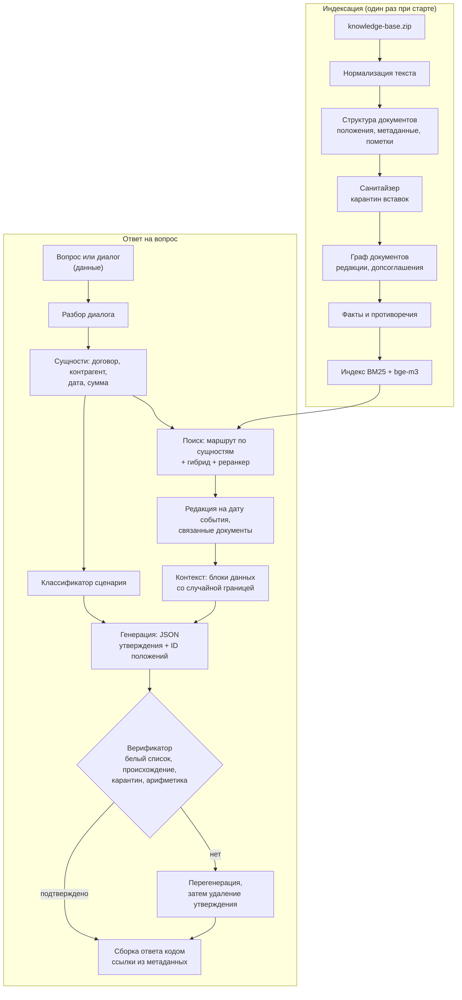

# Целевая архитектура

Документ описывает, к чему мы идём, и почему именно так. Детальные решения оформляем в `docs/adr/` (формат: контекст → варианты → решение → последствия). Ссылки вида PSB-N ведут на задачи в Jira.

## Принципы

1. **Граница доверия.** Инструкции — только из нашего кода. База знаний, вопрос и история диалога — данные. Подробно — в [модели угроз](07-security.md).
2. **Логика в коде, а не в одном промпте.** DeepSeek V4.1 Flash быстрая, но не самая сильная модель. Всё, что можно решить детерминированно (поиск документа по номеру, выбор редакции по дате, проверка чисел, формирование ссылок), решаем кодом.
3. **Каждый факт проверяем.** Выдумка обнуляет вопрос, поэтому структурированный вывод и верификатор — обязательные шаги.
4. **Один пайплайн для сабмита и веб-чата.** `solution.py` и HTTP API вызывают одно и то же ядро.
5. **Деградация вместо падения.** Недоступен эмбеддер — работаем на BM25. Кончается время — отключаем дорогие шаги. Файл ответа создаётся всегда.

## Пайплайн



## Компоненты

| Компонент | Ответственность | Задачи |
|---|---|---|
| Загрузка базы | Чтение ZIP: TXT и MD — PSB-9, DOCX — вместе с поиском скрытого текста в PSB-12; тип документа | PSB-9, PSB-10, PSB-12 |
| Нормализация | NFKC, невидимые символы, гомоглифы, скрытый текст DOCX | PSB-12 |
| Структура документа | Положения с адресом («п. 3.1», «ст. 70, абз. 9»), метаданные, редакционные пометки | PSB-9, PSB-10 |
| Санитайзер | Роль каждого фрагмента, карантин инструкций | PSB-12 |
| Граф документов | Допсоглашения, редакции, письма-дополнения | PSB-11 |
| Факты и противоречия | Извлечение фактов, иерархия источников | PSB-54 |
| Каталог сущностей | Контрагенты, номера, алиасы, косвенные признаки | PSB-13 |
| Индекс | BM25 + эмбеддинги, предрасчёт и проверка хеша базы | PSB-14, PSB-16 |
| Маршрутизатор | Документ целиком при явной сущности, связанные документы | PSB-17 |
| Редакции | Дата события → применимая редакция | PSB-18 |
| Классификатор | Сценарий запроса (см. [сценарии](03-scenarios.md)) | PSB-22 |
| Сборка контекста | Блоки данных, случайная граница, экранирование ролей | PSB-52 |
| Генератор | Промпт по сценарию, JSON с утверждениями | PSB-23, PSB-53 |
| Верификатор | Белый список, происхождение, карантин, перегенерация | PSB-31, PSB-32 |
| Сборка ответа | Текст по контракту, ссылки из метаданных | PSB-53 |
| Клиент прокси | chat / embeddings / rerank, повторы, тайм-ауты | PSB-4 |
| Оркестратор | Бюджет времени, параллелизм, запись `submission.csv` | PSB-5 |
| HTTP API и UI | Чат, источники, просмотр документа, срабатывания защиты | PSB-41, PSB-42 |

## Положения: адрес, ссылка, идентификатор

Положение — наименьшая единица, на которую ссылается ответ. Разбор выбирает способ деления по строению текста, а не по жанру: записка с нумерованными пунктами делится как регламент.

| Что | Как устроено | Пример |
|---|---|---|
| Документ с пунктами | Положение — пункт. Заголовки разделов и вводные пункты хранятся как путь | `п. 4.2`, путь: раздел 4 «Порядок расчётов» |
| Документ без пунктов | Положение — абзац основного текста, счёт с первого абзаца после шапки | `абз. 3` |
| Строки до первого пункта или абзаца | Шапка и вводная часть | `преамбула` |
| Ссылка | Собирается кодом из названия документа в тексте и адреса. У документа с редакциями в название входит редакция | «Договор поставки № П-17/2024, п. 4.2»; «Регламент … в редакции от 01.03.2025, п. 2.4» |
| Идентификатор положения | Идентификатор документа и порядковый номер положения в нём. Модель возвращает его в JSON, верификатор по нему находит текст | `d03.7` |
| Заголовок фрагмента для индекса | Документ, стороны, путь разделов, адрес | «Договор поставки № П-17/2024 (ООО «Альфа-Трейд», ООО «Меридиан»), раздел 4 «Порядок расчётов», п. 4.2» |

Метаданные документа (вид, номер, дата, стороны, редакция, статус) читаются из шапки текста. Имя файла используется только как название, если шапки в тексте нет. Статус «утратил силу» ставится по явной пометке в шапке; срок действия из условий договора в метаданные не извлекается — это работа карты связей (PSB-11).

## Почему такой поиск

- **База маленькая** (около 490 КБ текста), но законы длинные и однотипные (НК ст. 164 и 284). Документы компании короткие и хорошо адресуются по номеру и контрагенту.
- **Векторный поиск плохо различает «П-17/2024» и «ПТ-05/2023»**, «Альфа-Трейд» и «Альфа-Трейдинг». Для этого нужны лексический поиск и каталог сущностей.
- **Векторный поиск нужен для перефразировок**: «можно ли сдать часть склада другой фирме» → субаренда, п. 4.2.
- **Реранкер** — кандидат на отключение, если не даёт прироста на golden-наборе при своей цене по времени.

## Почему структурированный вывод

Свободный текст можно проверить только эвристиками. JSON с утверждениями и идентификаторами положений даёт точную проверку: каждое утверждение сверяется с конкретным положением, ссылка на положение вне контекста невозможна, а текст ссылки формирует код. Это главный механизм против выдуманных норм.

## Бюджет вызовов на вопрос (ориентир)

| Шаг | Вызовы | Когда |
|---|---|---|
| Эмбеддинг запроса | 1 | всегда, если доступен |
| Реранкер | 1 | при запасе времени |
| Классификатор | 0–1 | если правила не дали уверенного ответа |
| Генерация | 1 | всегда |
| Перегенерация | 0–1 | только при провале верификации |
| Проверка подтверждения | 0–1 | при запасе времени (PSB-33) |

Итого 2–6 вызовов. LLM-классификатор санитайзера работает один раз при индексации, а не на каждый вопрос. Сколько вопросов успеваем за 17 минут, меряем в PSB-39.

## Ограничения платформы, влияющие на код

- В сабмит попадают только **корневые** `.py`-файлы. Как совместить это с нормальной структурой репозитория, решается в ADR (PSB-2).
- Сторонние пакеты — только из `requirements.txt` организаторов. Локальной модели эмбеддингов нет.
- Версия Python на платформе не указана. Код пишем совместимым с Python 3.10+, фактическую версию выясняем первым сабмитом и фиксируем здесь.

## Целевая структура репозитория

Раскладка ядра под плоский ZIP — [ADR 0001](adr/0001-flat-submission-modules.md).

```
src/                 solution.py и плоские модули lex_*.py (в ZIP копируются в корень)
web/                 HTTP API и интерфейс (в сабмит не входит)
eval/                golden-набор, шаблоны атак, локальный судья, отчёты
scripts/             сборка ZIP, прогон в «платформенном» контейнере
tests/               модульные, контрактные и состязательные тесты
docs/                эта документация и ADR
requirements.txt     пакеты организаторов
Dockerfile, compose.yaml, .dockerignore, .env.example
```
