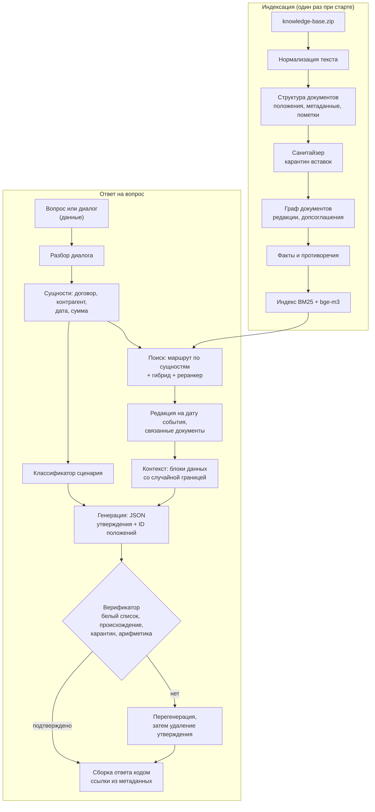

# Целевая архитектура

Документ описывает, к чему мы идём, и почему именно так. Детальные решения оформляем в `docs/adr/` (формат: контекст → варианты → решение → последствия). Ссылки вида PSB-N ведут на задачи в Jira.

## Принципы

1. **Граница доверия.** Инструкции — только из нашего кода. База знаний, вопрос и история диалога — данные. Подробно — в [модели угроз](07-security.md).
2. **Логика в коде, а не в одном промпте.** DeepSeek V4.1 Flash быстрая, но не самая сильная модель. Всё, что можно решить детерминированно (поиск документа по номеру, выбор редакции по дате, проверка чисел, формирование ссылок), решаем кодом.
3. **Каждый факт проверяем.** Выдумка обнуляет вопрос, поэтому структурированный вывод и верификатор — обязательные шаги.
4. **Один пайплайн для сабмита и веб-чата.** `solution.py` и HTTP API вызывают одно и то же ядро.
5. **Деградация вместо падения.** Недоступен эмбеддер — работаем на BM25. Кончается время — отключаем дорогие шаги. Файл ответа создаётся всегда.

## Пайплайн



## Компоненты

| Компонент | Ответственность | Задачи |
|---|---|---|
| Загрузка базы | Чтение ZIP: TXT, MD, DOCX (видимый текст отдельно от скрытого содержимого); тип документа | PSB-9, PSB-10, PSB-12 |
| Нормализация | Чистый текст, ключ сравнения, ключ детекции; находки (невидимые символы, tag-блок, bidi, смешение алфавитов, base64) | PSB-12 |
| Структура документа | Положения с адресом («п. 3.1», «ст. 70, абз. 9»), метаданные, редакционные пометки | PSB-9, PSB-10 |
| Санитайзер | Сигналы детекторов по каждому абзацу положения, решение о карантине, журнал | PSB-12 |
| Граф документов | Допсоглашения, редакции, письма-дополнения | PSB-11 |
| Факты и противоречия | Извлечение фактов, иерархия источников | PSB-54 |
| Каталог сущностей | Контрагенты, номера, алиасы, косвенные признаки | PSB-13 |
| Индекс | BM25 + эмбеддинги, предрасчёт и проверка хеша базы | PSB-14, PSB-16 |
| Маршрутизатор | Документ целиком при явной сущности, связанные документы | PSB-17 |
| Редакции | Дата события → применимая редакция | PSB-18 |
| Классификатор | Сценарий запроса (см. [сценарии](03-scenarios.md)) | PSB-22 |
| Сборка контекста | Блоки данных, случайная граница, экранирование ролей | PSB-52 |
| Генератор | Промпт по сценарию, JSON с утверждениями | PSB-23, PSB-53 |
| Верификатор | Белый список, происхождение, карантин, перегенерация | PSB-31, PSB-32 |
| Сборка ответа | Текст по контракту, ссылки из метаданных | PSB-53 |
| Клиент прокси | chat / embeddings / rerank, повторы, тайм-ауты | PSB-4 |
| Оркестратор | Бюджет времени, параллелизм, запись `submission.csv` | PSB-5 |
| HTTP API и UI | Чат, источники, просмотр документа, срабатывания защиты | PSB-41, PSB-42 |

## Положения: адрес, ссылка, идентификатор

Положение — наименьшая единица, на которую ссылается ответ. Разбор выбирает способ деления по строению текста, а не по жанру: записка с нумерованными пунктами делится как регламент.

| Что | Как устроено | Пример |
|---|---|---|
| Документ с пунктами | Положение — пункт. Заголовки разделов и вводные пункты хранятся как путь | `п. 4.2`, путь: раздел 4 «Порядок расчётов» |
| Документ без пунктов | Положение — абзац основного текста, счёт с первого абзаца после шапки | `абз. 3` |
| Строки до первого пункта или абзаца | Шапка и вводная часть | `преамбула` |
| Ссылка | Собирается кодом из названия документа в тексте и адреса. У документа с редакциями в название входит редакция | «Договор поставки № П-17/2024, п. 4.2»; «Регламент … в редакции от 01.03.2025, п. 2.4» |
| Идентификатор положения | Идентификатор документа и порядковый номер положения в нём. Модель возвращает его в JSON, верификатор по нему находит текст | `d03.7` |
| Заголовок фрагмента для индекса | Документ, стороны, путь разделов, адрес | «Договор поставки № П-17/2024 (ООО «Альфа-Трейд», ООО «Меридиан»), раздел 4 «Порядок расчётов», п. 4.2» |

Метаданные документа (вид, номер, дата, стороны, редакция, статус) читаются из шапки текста. Имя файла используется только как название, если шапки в тексте нет. Статус «утратил силу» ставится по явной пометке в шапке; срок действия из условий договора в метаданные не извлекается — это работа карты связей (PSB-11).

### Статьи законов

Статья закона — тот же `Document` с теми же `Provision`, `cite()` и `context_heading()`. Отличаются заголовок (`LawArticleHeader`) и адрес положения (`LawAddress` — путь единиц и, если единица поделена, диапазон абзацев). Номер единицы хранится строкой: в НК есть «1.8-3».

| Акт | Единица `1.` | Единица `1)` | Пример ссылки |
|---|---|---|---|
| Налоговый и Гражданский кодексы | пункт | подпункт | «НК РФ, ст. 164, п. 1, подп. 2.1» |
| КоАП, федеральные законы | часть | пункт | «152-ФЗ, ст. 9, ч. 4, п. 2» |
| Статья без единиц `1.` (ТК, 82-ФЗ) | часть — абзац с прописной буквы, счёт с первого | пункт | «ТК РФ, ст. 70, ч. 5» |
| Раздел «Примечания:» в КоАП | примечание, нумерация заново | пункт | «КоАП РФ, ст. 13.11, прим. 2» |

Положение — наименьшая нумерованная единица вместе со своими абзацами без номера: перечень из абзацев со строчной буквы и абзац санкции в КоАП остаются в одном положении с вводной фразой. Вводная фраза родителя («Налогообложение производится по налоговой ставке 0 процентов при реализации:») сама остаётся положением и входит в путь заголовков своих подпунктов. Обозначение единицы («1.», «2.1)») в текст положения не входит — оно в адресе.

Единица длиннее `MAX_PROVISION_LENGTH` (2000 знаков) делится по границам абзацев на положения с тем же адресом и диапазоном абзацев: «п. 1, абз. 6–13». Разрыв допустим только после абзаца, законченного точкой или точкой с запятой, поэтому диспозиция и санкция, вводная фраза и первый элемент перечня не разделяются. Продолжение поделённого перечня получает вводную фразу в путь заголовков. Текст между положениями не дублируется; окно с перекрытием для абзаца длиннее порога — дело индекса (PSB-16).

Строки выгрузки, которые не являются нормами, в текст положений не попадают:

| Строка | Признак | Куда попадает |
|---|---|---|
| «Источник:», «URL:», «Дата выгрузки:» | имя поля до строки «Статья N.» | `LawArticleHeader`: акт, краткое обозначение, адрес страницы, дата |
| Комментарий справочной системы | сокращённый год «2026 г.» (нормы пишут «года») или нет знака препинания в конце | `amendments`, если это пометка с адресом, иначе `comments` |
| Пометка с адресом: «Пункт 3 изменен с …», «Статья 9 дополнена частью 9 с …» | шаблон `_AMENDMENT` | `AmendmentNote(target, effective_from, source_act)`; адрес — единица, перед которой стоит пометка; `target=None` — статья целиком |
| Заглушка: «4. Утратил силу …», «Абзац второй исключен.», «Часть вторая утратила силу.» | шаблоны `_REPEALED_*` | `RepealedUnit`: номер пункта, абзаца или части занят, текста нормы нет |

Признаки комментария проверены на 13 статьях базы (888 строк после шапки). Норма, в которой год записан как «2026 г.», будет принята за комментарий — на другой базе это нужно перепроверить. Проверка полноты в тестах: строки шапки, пометки, комментарии, заглушки и положения вместе дают исходный текст.

## Нормализация текста

`lex_normalization.py` даёт три представления одного текста. Разбор документов работает с исходным текстом; чистый текст и ключи строятся из текста положения.

| Представление | Функция | Что делает | Кто читает |
|---|---|---|---|
| Оригинал | `normalize(text).original` | ничего | журнал санитайзера |
| Чистый текст | `clean_text(text)` | NFC; удаляет категории Cf, Cc (кроме перевода строки и табуляции), Co, Cn и невидимые символы других категорий: селекторы вариантов, заполнители хангыля, пустой шаблон Брайля | индекс, контекст модели |
| Ключ сравнения | `comparison_key(text)` | чистый текст, один регистр, ё→е, все кавычки → `"`, все тире → `-`, пробельные символы → один пробел | поиск, каталог сущностей, сверка строк (PSB-13, 16, 31) |
| Ключ детекции | `normalize(text).detection_key` | ключ сравнения после NFKC; в слове со смешением кириллицы и латиницы буквы меньшинства заменяются похожими буквами большинства (12 пар); в конец дописаны раскодированные tag-символы и блоки base64 | только детекторы вставок |

NFKC и свёртка похожих букв есть только в ключе детекции: NFKC превращает «№» в «No», «м²» в «м2», «Ⅳ» в «IV». Таблица confusables из Unicode TR39 для свёртки не годится: она отображает кириллицу в латиницу.

`normalize(text).findings` — что нормализация убрала или раскрыла: число невидимых символов, раскодированный tag-блок, bidi-управление, слова со смешением алфавитов, раскодированный base64. Метка порядка байтов и мягкий перенос удаляются без находки. Слово, в котором заменены все буквы, смешением не считается и не сворачивается. Блоки hex не раскодируются.

### DOCX

`lex_docx_reading.read_docx` читает видимый текст (абзацы и строки таблиц в порядке документа, ячейки через ` | `) в тот же вид, что у TXT: одна строка — один абзац. Скрытый текст (`w:vanish` у фрагмента, его стиля знаков или стиля абзаца), комментарии, колонтитулы и основные свойства документа попадают в `Document.hidden` с видом `HiddenContentKind` и в положения не входят. Не читаются: вложенные таблицы, сноски, надписи, пользовательские свойства, наследование `w:vanish` через базовый стиль, текст, скрытый цветом или размером шрифта. DOCX, который не открывается, — `KnowledgeBaseError` с именем файла.

## Санитайзер базы

| Модуль | Что в нём |
|---|---|
| `lex_detection.py` | `Fragment` (абзац положения или скрытое содержимое), `Signal`, `SignalStrength`, протокол `Detector.inspect(fragment) -> Signal` |
| `lex_address_detection.py` | `AddressDetector`: классы признаков обращения к ИИ-системе |
| `lex_structure_detection.py` | `StructureDetector` (разметка, метки ролей, скрытый текст, текст после подписи), `ConcealmentDetector` (находки нормализации) |
| `lex_sanitizer.py` | `screen(base, detectors, thresholds) -> Screening`, `decide`, окно соседних абзацев, `admitted_text` |
| `lex_settings.py` | `SanitizerThresholds`: пороги агрегатора, маскировки и размер окна |

Санитайзер документы не меняет. `Screening` — журнал решений по `ProvisionId` и номеру абзаца; индекс (PSB-16) и сборка контекста (PSB-52) берут текст положения через `admitted_text`, верификатор (PSB-31) по тому же журналу отклоняет доказательства из карантина. Роль фрагмента отдельным `Enum` не заведена: её заменяют вердикт и признаки сигналов в журнале. Правила детекторов, измеренный recall и ограничения — в [модели угроз](07-security.md#санитайзер-базы).

## Почему такой поиск

- **База маленькая** (около 490 КБ текста), но законы длинные и однотипные (НК ст. 164 и 284). Документы компании короткие и хорошо адресуются по номеру и контрагенту.
- **Векторный поиск плохо различает «П-17/2024» и «ПТ-05/2023»**, «Альфа-Трейд» и «Альфа-Трейдинг». Для этого нужны лексический поиск и каталог сущностей.
- **Векторный поиск нужен для перефразировок**: «можно ли сдать часть склада другой фирме» → субаренда, п. 4.2.
- **Реранкер** — кандидат на отключение, если не даёт прироста на golden-наборе при своей цене по времени.

## Почему структурированный вывод

Свободный текст можно проверить только эвристиками. JSON с утверждениями и идентификаторами положений даёт точную проверку: каждое утверждение сверяется с конкретным положением, ссылка на положение вне контекста невозможна, а текст ссылки формирует код. Это главный механизм против выдуманных норм.

## Бюджет вызовов на вопрос (ориентир)

| Шаг | Вызовы | Когда |
|---|---|---|
| Эмбеддинг запроса | 1 | всегда, если доступен |
| Реранкер | 1 | при запасе времени |
| Классификатор | 0–1 | если правила не дали уверенного ответа |
| Генерация | 1 | всегда |
| Перегенерация | 0–1 | только при провале верификации |
| Проверка подтверждения | 0–1 | при запасе времени (PSB-33) |

Итого 2–6 вызовов. LLM-классификатор санитайзера работает один раз при индексации, а не на каждый вопрос. Сколько вопросов успеваем за 17 минут, меряем в PSB-39.

## Ограничения платформы, влияющие на код

- В сабмит попадают только **корневые** `.py`-файлы. Как совместить это с нормальной структурой репозитория, решается в ADR (PSB-2).
- Сторонние пакеты — только из `requirements.txt` организаторов. Локальной модели эмбеддингов нет.
- Версия Python на платформе не указана. Код пишем совместимым с Python 3.10+, фактическую версию выясняем первым сабмитом и фиксируем здесь.

## Целевая структура репозитория

Раскладка ядра под плоский ZIP — [ADR 0001](adr/0001-flat-submission-modules.md).

```
src/                 solution.py и плоские модули lex_*.py (в ZIP копируются в корень)
web/                 HTTP API и интерфейс (в сабмит не входит)
eval/                golden-набор, шаблоны атак, локальный судья, отчёты
scripts/             сборка ZIP, прогон в «платформенном» контейнере
tests/               модульные, контрактные и состязательные тесты; генератор атак kb_injection.py
docs/                эта документация и ADR
requirements.txt     пакеты организаторов
Dockerfile, compose.yaml, .dockerignore, .env.example
```
