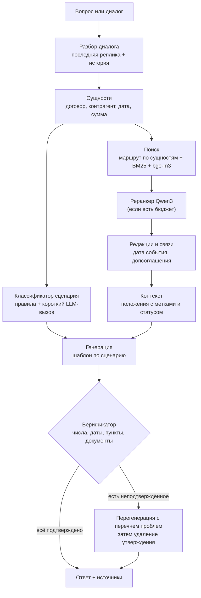

# Целевая архитектура

Документ описывает, к чему мы идём, и почему именно так. Детальные решения оформляем в `docs/adr/` (формат: контекст → варианты → решение → последствия). Ссылки вида PSB-N ведут на задачи в Jira.

## Принципы

1. **Логика в коде, а не в одном промпте.** DeepSeek V4.1 Flash быстрая, но не самая сильная модель. Всё, что можно решить детерминированно (поиск документа по номеру, выбор редакции по дате, проверка чисел), решаем кодом.
2. **Каждый факт в ответе проверяем.** Выдумка обнуляет вопрос, поэтому верификатор — не опция, а обязательный шаг.
3. **Один пайплайн для сабмита и для веб-чата.** `solution.py` и HTTP API вызывают одно и то же ядро.
4. **Деградация вместо падения.** Недоступен эмбеддер — работаем на BM25. Кончается время — отключаем дорогие шаги. Файл ответа создаётся всегда.

## Пайплайн



## Компоненты

| Компонент | Ответственность | Задачи |
|---|---|---|
| Загрузка базы | Чтение ZIP (TXT, MD, DOCX), определение типа документа | PSB-9, PSB-10 |
| Структура документа | Деление на положения с адресом («п. 3.1», «ст. 70, абз. 9»), метаданные, редакционные пометки | PSB-9, PSB-10 |
| Граф документов | Допсоглашения, редакции, письма-дополнения | PSB-11 |
| Санитайзер базы | Карантин встроенных инструкций | PSB-12 |
| Каталог сущностей | Контрагенты, номера, алиасы, косвенные признаки | PSB-13 |
| Индекс | BM25 + эмбеддинги, предрасчёт и проверка хеша базы | PSB-14, PSB-16 |
| Маршрутизатор | Документ целиком при явной сущности, связанные документы | PSB-17 |
| Редакции | Дата события → применимая редакция | PSB-18 |
| Классификатор | Сценарий запроса (см. [сценарии](03-scenarios.md)) | PSB-22 |
| Генератор | Промпт по сценарию, контракт ответа | PSB-23 |
| Верификатор | Детерминированная проверка + перегенерация | PSB-31, PSB-32 |
| Клиент прокси | chat / embeddings / rerank, повторы, таймауты | PSB-4 |
| Оркестратор | Бюджет времени, параллелизм, запись `submission.csv` | PSB-5 |
| HTTP API и UI | Чат, источники, просмотр документа | PSB-41, PSB-42 |

## Почему такой поиск

- **База маленькая** (около 490 КБ текста), но законы длинные и однотипные (НК ст. 164 и 284). Документы компании короткие и отлично адресуются по номеру и контрагенту.
- **Векторный поиск плохо различает «П-17/2024» и «ПТ-05/2023»**, «Альфа-Трейд» и «Альфа-Трейдинг». Для этого нужен лексический поиск и каталог сущностей.
- **Векторный поиск нужен для перефразировок**: «можно ли сдать часть склада другой фирме» → субаренда, п. 4.2.
- **Реранкер** — кандидат на отключение, если не даёт прироста на golden-наборе при своей цене по времени.

## Бюджет вызовов на вопрос (ориентир)

| Шаг | Вызовы | Когда |
|---|---|---|
| Эмбеддинг запроса | 1 | всегда, если доступен |
| Реранкер | 1 | при запасе времени |
| Классификатор | 0–1 | если правила не дали уверенного ответа |
| Генерация | 1 | всегда |
| Перегенерация | 0–1 | только при провале верификации |
| Проверка подтверждения | 0–1 | при запасе времени (PSB-33) |

Итого 2–6 вызовов. Сколько вопросов успеваем за 17 минут, меряем в PSB-39.

## Ограничения платформы, влияющие на код

- В сабмит попадают только **корневые** `.py`-файлы. Как совместить это с нормальной структурой репозитория, решается в ADR (PSB-2).
- Сторонние пакеты — только из `requirements.txt` организаторов. Локальной модели эмбеддингов нет.
- Версия Python на платформе не указана. Код пишем совместимым с Python 3.10+, фактическую версию выясняем первым сабмитом и фиксируем здесь.

## Целевая структура репозитория

```
solution.py          точка входа сабмита
<ядро>/              модули пайплайна (имя и способ сборки — ADR, PSB-2)
web/                 HTTP API и интерфейс
eval/                golden-набор, локальный судья, отчёты
scripts/             сборка ZIP, прогон в «платформенном» контейнере
tests/               модульные и контрактные тесты
docs/                эта документация и ADR
Dockerfile, compose.yaml, .dockerignore, .env.example
```
