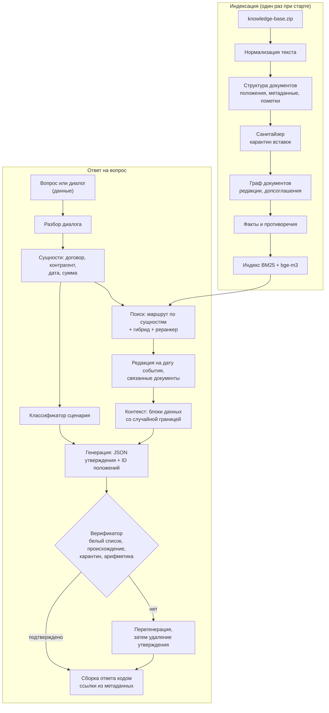

# Целевая архитектура

Документ описывает, к чему мы идём, и почему именно так. Детальные решения оформляем в `docs/adr/` (формат: контекст → варианты → решение → последствия). Ссылки вида PSB-N ведут на задачи в Jira.

## Принципы

1. **Граница доверия.** Инструкции — только из нашего кода. База знаний, вопрос и история диалога — данные. Подробно — в [модели угроз](07-security.md).
2. **Логика в коде, а не в одном промпте.** DeepSeek V4.1 Flash быстрая, но не самая сильная модель. Всё, что можно решить детерминированно (поиск документа по номеру, выбор редакции по дате, проверка чисел, формирование ссылок), решаем кодом.
3. **Каждый факт проверяем.** Выдумка обнуляет вопрос, поэтому структурированный вывод и верификатор — обязательные шаги.
4. **Один пайплайн для сабмита и веб-чата.** `solution.py` и HTTP API вызывают одно и то же ядро.
5. **Деградация вместо падения.** Недоступен эмбеддер — работаем на BM25. Кончается время — отключаем дорогие шаги. Файл ответа создаётся всегда.

## Пайплайн



## Компоненты

| Компонент | Ответственность | Задачи |
|---|---|---|
| Загрузка базы | Чтение ZIP: TXT, MD, DOCX (видимый текст отдельно от скрытого содержимого); тип документа | PSB-9, PSB-10, PSB-12 |
| Нормализация | Чистый текст, ключ сравнения, ключ детекции; находки (невидимые символы, tag-блок, bidi, смешение алфавитов, base64) | PSB-12 |
| Структура документа | Положения с адресом («п. 3.1», «ст. 70, абз. 9»), метаданные, редакционные пометки | PSB-9, PSB-10 |
| Санитайзер | Сигналы детекторов по каждому абзацу положения, решение о карантине, журнал | PSB-12 |
| Граф документов | Допсоглашения, редакции, письма-дополнения | PSB-11 |
| Факты и противоречия | Извлечение фактов, иерархия источников | PSB-54 |
| Каталог сущностей | Контрагенты и документы из шапок, падежные формы наименований, номера по частям; распознавание упоминаний в тексте | PSB-13 |
| Индекс | BM25 + эмбеддинги, предрасчёт и проверка хеша базы | PSB-14, PSB-16 |
| Маршрутизатор | Документ целиком при явной сущности, связанные документы | PSB-17 |
| Редакции | Дата события → применимая редакция | PSB-18 |
| Классификатор | Сценарий запроса (см. [сценарии](03-scenarios.md)) | PSB-22 |
| Сборка контекста | Правила в system; данные в блоках с меткой запроса; замена маркеров ролей видимыми знаками; проверка границы | PSB-52 |
| Генератор | Промпт по сценарию, JSON с утверждениями | PSB-23, PSB-53 |
| Верификатор | Белый список, происхождение, карантин, перегенерация | PSB-31, PSB-32 |
| Сборка ответа | Текст по контракту, ссылки из метаданных | PSB-53 |
| Клиент прокси | chat / embeddings / rerank, повторы, тайм-ауты | PSB-4 |
| Оркестратор | Бюджет времени, параллелизм, запись `submission.csv` | PSB-5 |
| HTTP API и UI | Чат, источники, просмотр документа, срабатывания защиты | PSB-41, PSB-42 |

## Положения: адрес, ссылка, идентификатор

Положение — наименьшая единица, на которую ссылается ответ. Разбор выбирает способ деления по строению текста, а не по жанру: записка с нумерованными пунктами делится как регламент.

| Что | Как устроено | Пример |
|---|---|---|
| Документ с пунктами | Положение — пункт. Заголовки разделов и вводные пункты хранятся как путь | `п. 4.2`, путь: раздел 4 «Порядок расчётов» |
| Документ без пунктов | Положение — абзац основного текста, счёт с первого абзаца после шапки | `абз. 3` |
| Строки до первого пункта или абзаца | Шапка и вводная часть | `преамбула` |
| Ссылка | Собирается кодом из названия документа в тексте и адреса. У документа с редакциями в название входит редакция | «Договор поставки № П-17/2024, п. 4.2»; «Регламент … в редакции от 01.03.2025, п. 2.4» |
| Идентификатор положения | Идентификатор документа и порядковый номер положения в нём. Модель возвращает его в JSON, верификатор по нему находит текст | `d03.7` |
| Заголовок фрагмента для индекса | Документ, стороны, путь разделов, адрес | «Договор поставки № П-17/2024 (ООО «Альфа-Трейд», ООО «Меридиан»), раздел 4 «Порядок расчётов», п. 4.2» |

Метаданные документа (вид, номер, дата, стороны, редакция, статус) читаются из шапки текста. Имя файла используется только как название, если шапки в тексте нет. Статус «утратил силу» ставится по явной пометке в шапке; срок действия из условий договора в метаданные не извлекается — это работа карты связей (PSB-11).

### Статьи законов

Статья закона — тот же `Document` с теми же `Provision`, `cite()` и `context_heading()`. Отличаются заголовок (`LawArticleHeader`) и адрес положения (`LawAddress` — путь единиц и, если единица поделена, диапазон абзацев). Номер единицы хранится строкой: в НК есть «1.8-3».

| Акт | Единица `1.` | Единица `1)` | Пример ссылки |
|---|---|---|---|
| Налоговый и Гражданский кодексы | пункт | подпункт | «НК РФ, ст. 164, п. 1, подп. 2.1» |
| КоАП, федеральные законы | часть | пункт | «152-ФЗ, ст. 9, ч. 4, п. 2» |
| Статья без единиц `1.` (ТК, 82-ФЗ) | часть — абзац с прописной буквы, счёт с первого | пункт | «ТК РФ, ст. 70, ч. 5» |
| Раздел «Примечания:» в КоАП | примечание, нумерация заново | пункт | «КоАП РФ, ст. 13.11, прим. 2» |

Положение — наименьшая нумерованная единица вместе со своими абзацами без номера: перечень из абзацев со строчной буквы и абзац санкции в КоАП остаются в одном положении с вводной фразой. Вводная фраза родителя («Налогообложение производится по налоговой ставке 0 процентов при реализации:») сама остаётся положением и входит в путь заголовков своих подпунктов. Обозначение единицы («1.», «2.1)») в текст положения не входит — оно в адресе.

Единица длиннее `MAX_PROVISION_LENGTH` (2000 знаков) делится по границам абзацев на положения с тем же адресом и диапазоном абзацев: «п. 1, абз. 6–13». Разрыв допустим только после абзаца, законченного точкой или точкой с запятой, поэтому диспозиция и санкция, вводная фраза и первый элемент перечня не разделяются. Продолжение поделённого перечня получает вводную фразу в путь заголовков. Текст между положениями не дублируется; окно с перекрытием для абзаца длиннее порога — дело индекса (PSB-16).

Строки выгрузки, которые не являются нормами, в текст положений не попадают:

| Строка | Признак | Куда попадает |
|---|---|---|
| «Источник:», «URL:», «Дата выгрузки:» | имя поля до строки «Статья N.» | `LawArticleHeader`: акт, краткое обозначение, адрес страницы, дата |
| Комментарий справочной системы | сокращённый год «2026 г.» (нормы пишут «года») или нет знака препинания в конце | `amendments`, если это пометка с адресом, иначе `comments` |
| Пометка с адресом: «Пункт 3 изменен с …», «Статья 9 дополнена частью 9 с …» | шаблон `_AMENDMENT` | `AmendmentNote(target, effective_from, source_act)`; адрес — единица, перед которой стоит пометка; `target=None` — статья целиком |
| Заглушка: «4. Утратил силу …», «Абзац второй исключен.», «Часть вторая утратила силу.» | шаблоны `_REPEALED_*` | `RepealedUnit`: номер пункта, абзаца или части занят, текста нормы нет |

Признаки комментария проверены на 13 статьях базы (888 строк после шапки). Норма, в которой год записан как «2026 г.», будет принята за комментарий — на другой базе это нужно перепроверить. Проверка полноты в тестах: строки шапки, пометки, комментарии, заглушки и положения вместе дают исходный текст.

## Нормализация текста

`lex_normalization.py` даёт три представления одного текста. Разбор документов работает с исходным текстом; чистый текст и ключи строятся из текста положения.

| Представление | Функция | Что делает | Кто читает |
|---|---|---|---|
| Оригинал | `normalize(text).original` | ничего | журнал санитайзера |
| Чистый текст | `clean_text(text)` | NFC; удаляет категории Cf, Cc (кроме перевода строки и табуляции), Co, Cn и невидимые символы других категорий: селекторы вариантов, заполнители хангыля, пустой шаблон Брайля | индекс, контекст модели |
| Ключ сравнения | `comparison_key(text)` | чистый текст, один регистр, ё→е, все кавычки → `"`, все тире → `-`, пробельные символы → один пробел | поиск, каталог сущностей, сверка строк (PSB-13, 16, 31) |
| Ключ детекции | `normalize(text).detection_key` | ключ сравнения после NFKC; в слове со смешением кириллицы и латиницы буквы меньшинства заменяются похожими буквами большинства (12 пар); в конец дописаны раскодированные tag-символы и блоки base64 | только детекторы вставок |
| Ключ детекции с позициями | `detection_alignment(text)` | тот же ключ для видимого текста: пробелы не свёрнуты, разрывы строк на месте, раскодированных блоков нет; для каждого знака ключа известна позиция знака в тексте | замена маркеров ролей (PSB-52) |

NFKC и свёртка похожих букв есть только в ключе детекции: NFKC превращает «№» в «No», «м²» в «м2», «Ⅳ» в «IV». Таблица confusables из Unicode TR39 для свёртки не годится: она отображает кириллицу в латиницу.

`normalize(text).findings` — что нормализация убрала или раскрыла: число невидимых символов, раскодированный tag-блок, bidi-управление, слова со смешением алфавитов, раскодированный base64. Метка порядка байтов и мягкий перенос удаляются без находки. Слово, в котором заменены все буквы, смешением не считается и не сворачивается. Блоки hex не раскодируются.

### DOCX

`lex_docx_reading.read_docx` читает видимый текст (абзацы и строки таблиц в порядке документа, ячейки через ` | `) в тот же вид, что у TXT: одна строка — один абзац. Скрытый текст (`w:vanish` у фрагмента, его стиля знаков или стиля абзаца), комментарии, колонтитулы и основные свойства документа попадают в `Document.hidden` с видом `HiddenContentKind` и в положения не входят. Не читаются: вложенные таблицы, сноски, надписи, пользовательские свойства, наследование `w:vanish` через базовый стиль, текст, скрытый цветом или размером шрифта. DOCX, который не открывается, — `KnowledgeBaseError` с именем файла.

## Санитайзер базы

| Модуль | Что в нём |
|---|---|
| `lex_detection.py` | `Fragment` (абзац положения или скрытое содержимое), `Signal`, `SignalStrength`, протокол `Detector.inspect(fragment) -> Signal` |
| `lex_address_detection.py` | `AddressDetector`: классы признаков обращения к ИИ-системе |
| `lex_structure_detection.py` | `StructureDetector` (разметка, метки ролей, скрытый текст, текст после подписи), `ConcealmentDetector` (находки нормализации) |
| `lex_sanitizer.py` | `screen(base, detectors, thresholds) -> Screening`, `decide`, окно соседних абзацев, `admitted_text` |
| `lex_settings.py` | `SanitizerThresholds`: пороги агрегатора, маскировки и размер окна |
| `lex_injection_prompt.py` | Промпт классификатора `INJECTION_CLASSIFIER_PROMPT_V1`, примеры, сборка сообщений |
| `lex_injection_classifier.py` | `classify(fragment, model, marker)`, `review_suspects(screening, model, next_marker)`: решение по фрагментам со слабым сигналом за протоколом `ChatModel` |

Санитайзер документы не меняет. `Screening` — журнал решений по `ProvisionId` и номеру абзаца; индекс (PSB-16) берёт текст положения через `admitted_text`, сборка контекста (PSB-52) — через `admit`, которая возвращает `AdmittedProvision` или `None` для положения в карантине, верификатор (PSB-31) по тому же журналу отклоняет доказательства из карантина. Роль фрагмента отдельным `Enum` не заведена: её заменяют вердикт и признаки сигналов в журнале. Правила детекторов, измеренный recall и ограничения — в [модели угроз](07-security.md#санитайзер-базы).

## Сборка контекста

| Модуль | Что в нём |
|---|---|
| `lex_sanitizer.py` | `AdmittedProvision(id, heading, text)` и `admit(document, provision, screening)`: единственный вход положений в контекст |
| `lex_role_markers.py` | `find_role_markers(text)`, `neutralize_role_markers(text)`: классы маркеров ролей и токенов чат-шаблонов, замена краёв знаками ‹ и › |
| `lex_prompt_boundary.py` | `assemble_prompt(rules, provisions, history, question, boundary) -> list[ChatTurn]`, `boundary_violations(turns, rules, boundary)`, `Boundary`, `random_boundary()`, `PromptRules(system, reminder)`, пояснение к блокам `DATA_LEGEND_V1` |

Порядок в запросе: правила (system) → пояснение к блокам → блоки `provision` в порядке, заданном вызывающим кодом → блоки `turn` → блок `question` → повтор правил. Сборка ничего не ищет и не отбирает: положения и их порядок приходят от поиска, текст правил и повтора — от модуля промптов (PSB-23). Вопрос — строка, история — последовательность строк-реплик; тип диалога из PSB-24 приводится к ним в месте вызова.

Метку запроса создаёт точка входа (`random_boundary()`), в сборку она приходит значением. Метка в данных и идентификатор положения, который ломает открывающую строку блока, — `PromptBoundaryError`. Формат блоков, классы маркеров, причины решений и ограничения — в [модели угроз](07-security.md#граница-доверия-в-промпте).

## Каталог сущностей

`lex_entity_catalog.build_catalog(base)` собирает `EntityCatalog` из шапок документов компании. Имена файлов и заранее известные наименования не используются; статьи законов в каталог не входят.

| Что | Откуда | Как хранится |
|---|---|---|
| Контрагент (`Counterparty`) | `DocumentHeader.parties` | наименование как в шапке, ИНН, роли по всем документам, документы, слова наименования (`NameToken`) |
| Документ (`DocumentEntry`) | шапка | вид, заголовок для ссылки, номер по частям (`DocumentNumber`), дата редакции |

**Один контрагент.** Стороны с одним наименованием (по `comparison_key`) — один контрагент, пока ИНН у наименования не больше одного: в допсоглашении сторона названа без ИНН. Два ИНН у одного наименования — два контрагента, сторона без ИНН остаётся третьей записью.

**Слова наименования.** Берётся текст в кавычках, без них — наименование без организационно-правовой формы в начале; дефис и пробел равнозначны: «ООО «Альфа-Трейд»» → «альфа», «трейд». Для каждого слова `lex_declension.case_forms` порождает падежные формы по закрытой таблице окончаний именительного падежа (21 окончание и слова на согласную, беглая гласная в «-ок/-ек/-ец»). Слово из вопроса сравнивается с формами целиком, поэтому «трейдинг» не форма слова «трейд». Латиница, слова с цифрами и слова короче трёх букв не склоняются. Стеммер Snowball для этого не годится: он даёт разные основы у «Меридиан» и «Меридианом» и одну у «Гарант» и «Гарантия».

**Обычное слово.** `NameToken.common` — какая-то форма слова встречается в положениях базы целиком строчными буквами («склад» в «склад № 3»). Такое слово в одиночку контрагента не называет.

**Номера.** `lex_document_numbers` разбирает номер на префикс, число и год: «П-17/2024», «П-17-2024», «п17/2024», «П 17/2024», «п-17/24», «П-017/2024» — один номер. Сравнение точное и по частям, без нечёткого: «П-17/2023» — другой документ. Префикс сравнивается в трёх прочтениях: как набрано, по начертанию (латинская «A» → «А») и по звучанию (латинская «P» → «П»). Без года номером считается только запись через дефис («ЮО-7»), иначе номером стал бы «п. 17». Номер другого вида («№ 1» допсоглашения, «14-П») в части не разбирается, и по номеру такой документ не находится.

### Распознавание упоминаний

`lex_entity_recognition.recognize(text, catalog)` возвращает `Mention(text, resolution)` на каждое упоминание в порядке появления. Результат даётся на упоминание, а не на вопрос: «сравни П-17/2024 и договор с «Альфа-Трейдингом»» — два результата, и расхождение номера с наименованием видно вызывающему. `resolution` — одно из трёх: `Resolved(entity, evidence)`, `Ambiguous(candidates, evidence)`, `NotFound(similar)`.

| Уровень (`Evidence`) | Что совпало |
|---|---|
| `IDENTIFIER` | ИНН из каталога; номер документа так, как он стоит в шапке: префикс, число и год |
| `FULL_NAME` | все слова наименования подряд, каждое в любой падежной форме; между словами пробел или дефис |
| `PARTIAL` | часть наименования из слов подряд («Альфа»); номер без года («П-17») |
| `FUZZY` | наименование с опечаткой; ответ должен назвать контрагента полностью |

Правила, в порядке применения:

1. **Совпадения с одним и тем же местом текста** сводятся к сильнейшему уровню; при равном уровне именительный падеж сильнее косвенного («Логистика» — это ООО «Логистика», а не родительный падеж ООО «Логистик»). Остался один кандидат — `Resolved`, несколько — `Ambiguous` со всеми кандидатами.
2. **Самое длинное совпадение гасит пересекающиеся:** «Альфа-Трейдинг» не даёт второго упоминания «Альфа».
3. **Когда возвращается `Ambiguous`:** часть наименования есть у нескольких контрагентов («Альфа», «с Альфой»); падежная форма общая у двух наименований и ни одно не стоит в именительном падеже; номер без года подходит к документам разных лет; опечатка не отделяет лучшего кандидата от остальных.
4. **Когда возвращается `NotFound`:** номер назван с годом, а документа с таким годом нет (`similar` — документы с тем же префиксом и числом); номер записан слитно с годом из четырёх цифр, и такой серии в базе нет; организационно-правовая форма с наименованием в кавычках, которого нет в каталоге («ООО «Альфа-Банк»»). Обычный текст без этих признаков упоминанием не считается, результат — пустой кортеж.
5. **Заглавная буква или кавычки** обязательны для части наименования, для наименования из одного слова и для наименования из одних обычных слов базы. Строчными буквами узнаётся только полное наименование из нескольких слов («у альфа-трейда»). Слово «склад» частью наименования не становится никогда: «к нашему складу в Химках» — не упоминание.
6. **Границы наименования:** совпадение не разрывает слово через дефис («Альфа-Банк») и текст в кавычках («Альфа Банк» в кавычках) — это другое наименование.
7. **Опечатки** проверяются только там, где нет точного совпадения. Расстояние OSA (перестановка соседних букв — одна правка) считается по словам до ближайшей падежной формы; лимит по длине именительного падежа: до 5 букв — 0, 5–8 — 1, от 9 — 2. `Resolved` — если остальные кандидаты дальше лучшего не меньше чем на 2 правки, иначе `Ambiguous`. Скореры `partial_ratio` и `WRatio` не используются: на паре «трейд» — «трейдинг» они дают 100 и 90.
8. **Номера и ИНН** сравниваются только точно.

**Диалог.** `recognize` принимает текст одной реплики. `combine_turns(turns)` объединяет результаты нескольких реплик и снимает `Ambiguous`, когда ровно один из его кандидатов назван в переданных репликах однозначно (демо 17: «с Альфой» → «Альфа-Трейдинг»). Какие реплики передавать, решает разбор диалога (PSB-24): реплика ассистента в демо 17 называет обоих кандидатов и неоднозначность не снимает.

Ограничения, проверенные на базе и записанные в `tests/golden/entity_recognition.yaml`:

- настоящее слово в одной правке от наименования даёт `FUZZY`: «альфа трейдер» → ООО «Альфа-Трейд»;
- «Северный» в начале предложения — `PARTIAL` для ООО «Северный Склад»; без кавычек и дефиса «Альфа Банк» даёт `Ambiguous` по слову «Альфа»;
- косвенные признаки (предмет договора, адрес объекта) не используются: «„Альфа“ привезла мебель» остаётся `Ambiguous`;
- регламент по названию и статья закона по номеру («ст. 70 ТК») не распознаются: в каталоге только контрагенты и номера документов компании.

## Граф документов

`lex_document_graph.build_graph(base)` строит неизменяемый `DocumentGraph` из текста документов компании. Имена файлов не используются; статьи законов в граф не входят. Решения и отвергнутые варианты — в [ADR 0002](adr/0002-document-graph.md).

| Модуль | Что в нём |
|---|---|
| `lex_document_links.py` | `find_link_statements(document)`: утверждения о связях в тексте одного документа. Адресат записан так, как его называет источник (`DocumentReference`: слова названия, номер, дата редакции) |
| `lex_document_graph.py` | `build_graph`: поиск адресата в базе, семейства редакций, запросы к графу |

| Связь (`LinkKind`) | Признак в тексте | Пример |
|---|---|---|
| `AMENDS` | строка «к <документу> № …» в шапке дополнительного соглашения | «к договору поставки № П-17/2024 от 12 февраля 2024 г.» |
| `SUPERSEDES` | «Редакция от <дата> утрачивает силу» с датой другой редакции | регламент в редакции от 01.03.2025 → редакция от 10.01.2023 |
| `REPLACES_PROVISION` | «Изложить пункт N … в следующей редакции:» и текст в кавычках за ним | допсоглашение № 1 → п. 3.2 договора П-17/2024 |
| `SUPPLEMENTS` | «в дополнение к … п. N <Название> (ред. от <дата>)» | письмо К-12 → п. 5.4 регламента в редакции от 01.03.2025 |

`Link` хранит источник, положение источника, в котором связь названа (`stated_in`), адресата дословно (`reference`), найденный документ (`target`), названный пункт и его положение (`clause`, `target_provision`), дату начала действия (`effective_from`) и условие применения (`condition`). Связь без единственного адресата остаётся в графе с `target=None`.

| Запрос | Что возвращает |
|---|---|
| `amendments_of(document)` | допсоглашения к документу |
| `links_from(document)`, `links_to(document)` | связи, названные в документе, и связи, которые на него указывают |
| `family_of(document)` | `EditionFamily` — редакции одного документа с периодами `effective_from`/`effective_to`; `None`, если у документа нет даты редакции |
| `EditionFamily.edition_at(date)` | редакция, действовавшая на дату; `None` — такой редакции в базе нет |
| `versions_of(provision_id)` | исходный текст пункта и его новые редакции (`ProvisionVersion`); пусто, если пункт не менялся |
| `unresolved` | связи без адресата или без названного пункта в адресате |

Конец периода — первый день, когда редакция уже не действует: у регламента 2023 года это 01.03.2025, и `edition_at(01.03.2025)` возвращает редакцию 2025 года. Изменённый пункт не переписывается: текст положения в базе остаётся исходным, новая редакция лежит в графе рядом с ним. У новой версии есть `changed_by`, `effective_from` и `condition` — текст условия дословно и положение, откуда он взят («Новый адрес доставки применяется к партиям Товара, Спецификации на которые подписаны после 1 октября 2024 г.», допсоглашение № 1, абз. 3). Условие код не вычисляет: сборка контекста (PSB-52) отдаёт модели обе версии и условие.

Что граф не извлекает: ссылки на положение другого документа без слов «в дополнение к», связи по теме без названного документа, приложения и спецификации к договору.

## Дата события и редакция

Решения и отвергнутые варианты — в [ADR 0003](adr/0003-event-date-and-edition.md).

### Дата события

`lex_dates.PartialDate(start, precision)` — дата с точностью до дня, месяца или года; это период с первым днём `start` и первым днём после него `end`. `find_dates(text)` находит «01.08.2024», «1 августа 2024 г.», «в августе 2024 года», «в 2024 году» и место каждой даты в тексте. Тип общий: им же верификатор (PSB-31) будет сверять даты ответа.

`lex_event_date.read_event_date(question, today)` читает дату события. День вопроса `today` передаёт вызывающий, системное время ядро не читает. Относительные даты считаются календарными периодами: «в прошлом году» — предыдущий календарный год, «в прошлом месяце» — предыдущий месяц, «вчера» — предыдущий день.

| Результат | Когда |
|---|---|
| `EventDate(period, wording)` | В вопросе одна дата, и она стоит не после «от» |
| `UnclearEventDate(candidates, incomplete)` | Дат несколько; единственная дата — реквизит документа («в редакции от 02.02.2029»); дату нельзя вычислить («в августе» без года, «два года назад») |
| `None` | Дат и слов о времени нет |

Между несколькими датами код не выбирает: все даты возвращаются в порядке текста с ролью (`STATED` или `DOCUMENT_DATE`).

### Редакция документа компании

`lex_edition_choice.edition_on(family, period, base)` выбирает редакцию семейства из [графа](#граф-документов) для названного периода; `current_edition(family, today, base)` — для вопроса без даты.

| Результат | Когда | Что делает ответ |
|---|---|---|
| `EditionInForce(edition, date_stated=True)` | Весь период приходится на одну редакцию | Отвечает по ней |
| `EditionInForce(edition, date_stated=False)` | Даты в вопросе нет | Отвечает по действующей и говорит об этом одной фразой |
| `EditionsAcrossBoundary(editions, boundaries)` | Период захватывает смену редакций: «в 2025 году» при смене 01.03.2025 | Приводит оба варианта с днём смены или просит уточнить дату |
| `NoEditionOnDate(reason)` | Дата раньше первой редакции либо редакция утратила силу, а следующей нет | Говорит, что редакции на эту дату в базе нет |
| `RepealDateUnknown(edition)` | «Утратила силу» без даты, следующей редакции нет | Говорит, что дата утраты силы в базе не названа |

День смены относится к новой редакции: 28.02.2025 — редакция 2023 года, 01.03.2025 — редакция 2025 года. Суммы и пороги модуль не читает: он выбирает документ, а положение с порогом находит поиск.

### Норма закона на дату события

Прежних редакций норм в базе нет. `lex_law_validity.law_text_on(header, address, period)` по пометкам об изменениях отвечает, относится ли текст базы к дате события; `law_text_as_retrieved(header, address)` — для вопроса без даты.

| Результат | Когда |
|---|---|
| `LawTextInForce(amended, date_stated)` | Дата события не раньше последнего изменения единицы, её родителя и статьи |
| `LawTextNewer(amended)` | Норма изменена позже даты события: редакции на эту дату в базе нет |
| `LawTextUncertain(reason, note)` | Определить нельзя: будущая пометка (`PENDING_AMENDMENT`), неполная дата захватывает день изменения (`SPANS_AMENDMENT`), дата позже выгрузки (`AFTER_RETRIEVAL`), даты выгрузки нет (`NO_RETRIEVAL_DATE`) |

ТК РФ, ст. 59 выгружена 10.10.2026 с пометкой «изменена с 1 марта 2027 г.». Из файла не следует, учтено ли это изменение в тексте, поэтому для даты события с 01.09.2026 и для вопроса без даты исход — `PENDING_AMENDMENT` с этой пометкой; для даты до 01.09.2026 — `LawTextNewer`.

Исход говорит о редакции текста, а не о применимости нормы: комментарии вида «Положения подпункта 6 применяются по 31 декабря 2027 г. включительно» не учитываются.

## Почему такой поиск

- **База маленькая** (около 490 КБ текста), но законы длинные и однотипные (НК ст. 164 и 284). Документы компании короткие и хорошо адресуются по номеру и контрагенту.
- **Векторный поиск плохо различает «П-17/2024» и «ПТ-05/2023»**, «Альфа-Трейд» и «Альфа-Трейдинг». Для этого нужны лексический поиск и каталог сущностей.
- **Векторный поиск нужен для перефразировок**: «можно ли сдать часть склада другой фирме» → субаренда, п. 4.2.
- **Реранкер** — кандидат на отключение, если не даёт прироста на golden-наборе при своей цене по времени.

## Почему структурированный вывод

Свободный текст можно проверить только эвристиками. JSON с утверждениями и идентификаторами положений даёт точную проверку: каждое утверждение сверяется с конкретным положением, идентификатор положения вне контекста отклоняется по белому списку, а текст ссылки формирует код. Белый список проверяет только идентификаторы; текст утверждения сверяет с положением верификатор (PSB-31). Это главный механизм против выдуманных норм.

## Бюджет вызовов на вопрос (ориентир)

| Шаг | Вызовы | Когда |
|---|---|---|
| Эмбеддинг запроса | 1 | всегда, если доступен |
| Реранкер | 1 | при запасе времени |
| Классификатор | 0–1 | если правила не дали уверенного ответа |
| Генерация | 1 | всегда |
| Перегенерация | 0–1 | только при провале верификации |
| Проверка подтверждения | 0–1 | при запасе времени (PSB-33) |

Итого 2–6 вызовов. LLM-классификатор санитайзера работает один раз при индексации, а не на каждый вопрос. Сколько вопросов успеваем за 17 минут, меряем в PSB-39.

## Ограничения платформы, влияющие на код

- В сабмит попадают только **корневые** `.py`-файлы. Как совместить это с нормальной структурой репозитория, решается в ADR (PSB-2).
- Сторонние пакеты — только из `requirements.txt` организаторов. Локальной модели эмбеддингов нет.
- Версия Python на платформе не указана. Код пишем совместимым с Python 3.10+, фактическую версию выясняем первым сабмитом и фиксируем здесь.

## Целевая структура репозитория

Раскладка ядра под плоский ZIP — [ADR 0001](adr/0001-flat-submission-modules.md).

```
src/                 solution.py и плоские модули lex_*.py (в ZIP копируются в корень)
web/                 HTTP API и интерфейс (в сабмит не входит)
eval/                golden-набор, шаблоны атак, локальный судья, отчёты
scripts/             сборка ZIP, прогон в «платформенном» контейнере
tests/               модульные, контрактные и состязательные тесты; генератор атак kb_injection.py
docs/                эта документация и ADR
requirements.txt     пакеты организаторов
Dockerfile, compose.yaml, .dockerignore, .env.example
```
