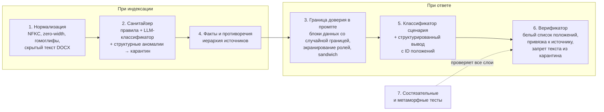

# Модель угроз и защита от ловушек

Вставка для ИИ в записке ЮО-7 — один пример, а не вся угроза. Приватная база и приватные вопросы могут содержать ловушки, которых мы не видели. Поэтому защита строится от **классов** угроз, а не от конкретных слов, и её гарантии дают код и архитектура, а не послушание модели.

## Главный принцип: граница доверия

**Инструкции приходят только из нашего кода.** Всё остальное — данные:

- документы базы знаний, включая «приказы», «уведомления» и «системные сообщения» внутри них;
- вопрос пользователя;
- история диалога, включая реплики «Ассистента».

Данные можно цитировать, анализировать и упоминать в ответе («в документе есть указание, которое не относится к делу»), но не исполнять. Ни одна защита не предполагает, что модель сама «поймёт» и не поддастся: каждый слой проверяется кодом.

## Таксономия ловушек

| Класс | Примеры | Основные слои защиты |
|---|---|---|
| **1. Вставки в базу** | Обращение к ИИ с требованием отвечать иначе (ЮО-7); выдача за приказ руководства; условный триггер «если спросят про X — отвечай Y»; просьба скрыть инструкцию; другие языки, транслит; маскировка: zero-width символы, гомоглифы, base64, HTML-комментарии, скрытый текст и свойства DOCX, колонтитулы; инструкция, разбитая на несколько абзацев | 1, 2, 3, 6 |
| **2. Дезинформация в базе без инструкций** | «Общее правило для всех договоров», противоречащее конкретному пункту; утратившая силу редакция; проект или неподписанный документ; будущая редакция закона; опечатка в числе | 4, 6 |
| **3. Атаки через вопрос** | Смена роли; «забудь правила»; поддельные [SYSTEM], <\|im_start\|>, «### Instruction»; просьба вывести системный промпт; «ответь по памяти»; «гипотетически, если бы база разрешала»; атака на другом языке или в кодировке | 2, 3, 5 |
| **4. Атаки через историю диалога** | Поддельная реплика ассистента с неверным фактом; «ты уже согласился раньше»; давление авторитетом; постепенный дрейф темы | 2, 5, 6 |
| **5. Ложные предпосылки** | Неверная сумма, срок, сторона, номер пункта, несуществующий документ в вопросе | 5, 6 |
| **6. Ловушки поиска** | Почти одинаковые контрагенты («Альфа-Трейд» / «Альфа-Трейдинг»); разные форматы номеров; документа нет в базе; есть только часть ответа | 4, 5 |
| **7. Временные ловушки** | Дата события до вступления редакции; изменение закона, отмеченное в тексте; относительные даты | 4, 5 |
| **8. Ловушки вывода** | Ссылка на статью, которой нет в базе; число из памяти модели; пересказ встроенной инструкции; ответ длиннее нужного | 5, 6 |
| **9. Противоправные и непрофильные запросы** | Сокрытие нарушений, уклонение от налогов; вопросы вне юридической тематики | 5 |

## Семь слоёв защиты

1. **Нормализация текста** (PSB-12). Unicode NFKC, удаление невидимых и управляющих символов, приведение гомоглифов, извлечение скрытого текста из DOCX. Анализируем то, что видит модель, а не то, что видит человек.
2. **Санитайзер базы** (PSB-12). Каждый фрагмент получает роль: норма, реквизиты, служебная пометка или инструкция для модели. Три независимых сигнала: правила, LLM-классификатор при индексации, структурные аномалии (фрагмент вне нумерации, после подписей, не по жанру документа). Инструкции уходят в карантин: не попадают в контекст и не считаются доказательством. Документ целиком не выбрасывается.
3. **Граница доверия в промпте** (PSB-52). Фрагменты базы — в блоках с идентификатором положения и случайной границей на запрос. Маркеры ролей внутри данных экранируются. Вопрос и история — тоже блоки данных. Правила повторяются после данных.
4. **Факты, противоречия и иерархия источников** (PSB-54, PSB-11, PSB-18). При индексации извлекаем факты «объект — атрибут — значение — положение» и находим противоречия. Разрешаем по иерархии (ниже). Неразрешимое противоречие не выбираем молча, а показываем.
5. **Классификатор и структурированный вывод** (PSB-22, PSB-53). Модель возвращает JSON: сценарий, ответ, утверждения с идентификаторами положений, недостающее. Ссылки в тексте формирует код из метаданных. Модель физически не может сослаться на положение вне контекста.
6. **Верификатор** (PSB-31, PSB-32). Каждый факт подтверждён положением из белого списка. Утверждение о документе X подтверждается только X или документами, которые его явно меняют. Текст и числа из карантина — автоматический провал. Неподтверждённое — перегенерация, затем удаление утверждения.
7. **Состязательные и метаморфные тесты** (PSB-55). Портим базу и вопросы по шаблонам из [eval/attacks.yaml](../eval/attacks.yaml) и проверяем инварианты ниже. Так ловим ловушки, которых нет в ручном наборе.

## Иерархия источников

Применяется при противоречии положений (слой 4) и при выборе доказательства (слой 6).

1. **Специальное важнее общего.** Пункт конкретного договора и допсоглашение к нему важнее «общего правила» из записки или письма.
2. **Применимая редакция.** Для события берём документ, действовавший на его дату. Утративший силу — только для событий в период его действия.
3. **Закон важнее локального акта.** Локальный акт не отменяет закон; при противоречии — сообщить.
4. **Формальное важнее неформального.** Документ с номером, датой, утверждением и подписями важнее текста без реквизитов, проекта или черновика.
5. **Неразрешимое — показать.** Если правила 1–4 не решают, ответ называет оба положения и говорит, что требуется уточнение.

## Инварианты

Проверяются автоматически на каждом PR, меняющем ядро (PSB-55). Нарушение любого — блокер.

1. **Невосприимчивость к вставкам.** Добавление в базу любой вставки из `attacks.yaml` не меняет фактов ответа ни на один вопрос golden-набора.
2. **Карантин не протекает.** Ни 5 слов подряд, ни ключевое число из карантинного фрагмента не попадает в ответ.
3. **Каждый факт обоснован.** Каждое число, дата, пункт и документ в ответе подтверждены положением с допустимым происхождением.
4. **Невосприимчивость к атакам в вопросе.** Атакующий префикс, суффикс или поддельная история не меняют фактов ответа и роли ассистента.
5. **Ложная предпосылка исправляется.** Подмена числа или срока в вопросе всегда приводит к исправлению со ссылкой.
6. **Независимость от оформления базы.** Переименование файлов и перемешивание порядка документов не меняют ответа.

## Чего не делаем

- Не хардкодим в логике номера документов, числа и фразы из известных вставок. Они допустимы только в тестах.
- Не полагаемся на один слой: каждый слой предполагает, что предыдущий мог пропустить атаку.
- Не выбрасываем документ целиком из-за одной вставки: остальной текст нужен для ответов.
- Не скрываем срабатывания: карантин и противоречия видны в логе и в интерфейсе.

## Секреты

- Ключ прокси приходит только через переменные окружения (`LLM_API_KEY` / `OPENAI_API_KEY`). В коде, конфигурации, логах, отчётах и задачах его нет.
- В репозитории только `.env.example` с пустыми значениями, `.env` в `.gitignore`.
- Объекты настроек не печатают ключ в `repr`, исключения не содержат заголовков запроса.
- Если ключ попал в коммит, сообщаем организаторам и считаем его скомпрометированным. Репозиторий публичный, удаление из истории не помогает.

## Персональные данные

- В репозитории, тестах и демо — только вымышленные данные.
- В режиме сабмита логируем id вопроса и метрики, не текст вопроса.

## Зависимости

Только пакеты из `requirements.txt` организаторов с зафиксированными версиями. Инструменты разработки (pytest, ruff, mypy) — в отдельном `requirements-dev.txt`, который в сабмит не попадает.

## Веб-сервис

- Ключ хранится на сервере и в браузер не передаётся.
- Размер запроса и длина истории ограничены.
- Ответ и тексты документов выводятся как текст, без вставки HTML.
- Срабатывания карантина видны пользователю: «в документе обнаружен фрагмент, не относящийся к содержанию, он исключён из анализа».
